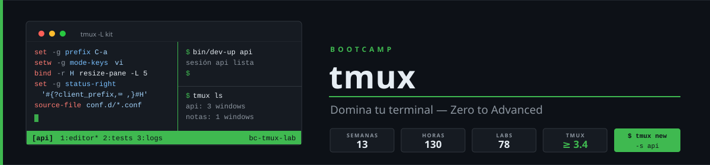

<p align="center">
  
</p>

<p align="center">
  <a href="LICENSE"></a>
  <a href="#"></a>
  <a href="#"></a>
  <a href="#"></a>
</p>

<p align="center">
  <a href="README_EN.md"></a>
</p>

---

## 📋 Descripción

Bootcamp **Zero to Advanced** de **13 semanas (~3 meses)** enfocado en el dominio de **tmux**, el multiplexor de terminal. Es autoestudio asincrónico de **10 h/semana** y 100% práctico: empiezas sin haber abierto tmux y terminas con un entorno de trabajo propio, configurado, scriptable y reproducible, que funciona en local, por SSH y en pair programming.

### 🎯 Objetivos

Al finalizar el bootcamp, serás capaz de:

- ✅ Explicar el modelo servidor/cliente de tmux y no volver a perder trabajo por un cierre de terminal o de SSH
- ✅ Moverte con fluidez entre sesiones, ventanas y paneles, y usar targets `sesion:ventana.panel`
- ✅ Copiar con copy-mode y buffers hasta el portapapeles del sistema, en local y por SSH (OSC 52)
- ✅ Escribir una configuración modular y entender los alcances server/session/window/pane
- ✅ Diseñar key bindings y tablas de teclas propias, con navegación sin prefix que respeta cualquier programa a pantalla completa
- ✅ Construir una status line propia con formats, condicionales y estilos, sin plugins
- ✅ Diagnosticar problemas de `TERM`, color de 24 bits, undercurl y teclas extendidas
- ✅ Automatizar entornos de proyecto con scripts idempotentes, hooks, popups y menús
- ✅ Usar plugins con criterio y escribir el tuyo propio
- ✅ Trabajar con tmux remoto y anidado, y compartir sesiones de forma segura

### 🔧 ¿Por qué tmux?

> **Tu terminal sobrevive a todo** — cierres, desconexiones, reinicios del emulador y cambios de máquina.

tmux es la herramienta que separa una terminal desechable de un entorno de trabajo. Está en cualquier servidor Linux, se controla por completo desde la línea de comandos y se automatiza con bash. Este bootcamp te lleva de "lo abro para no perder la sesión SSH" a "mi entorno se levanta con un comando".

---

## 🗓️ Estructura del Bootcamp

|         Fase           | Semanas | Horas | Temas Principales                                                    |
| :--------------------: | :-----: | :---: | -------------------------------------------------------------------- |
| **Fundamentos**        |   1-4   |  40h  | Servidor/cliente, ventanas, paneles, sesiones, copy mode             |
| **Configuración**      |   5-8   |  40h  | Opciones, key bindings, formats, status line, terminal y color       |
| **Automatización**     |  9-11   |  30h  | Scripting, hooks, popups, menús, plugins                             |
| **Avanzado**           |  12-13  |  20h  | Remoto, colaboración, control mode, proyecto integrador              |

**Total: 13 semanas** | **130 horas** | Índice con estado de cada semana: [bootcamp/README.md](bootcamp/README.md)

---

## 📚 Contenido por Semana

Cada semana incluye:

```
bootcamp/week-NN-nombre_del_tema/
├── README.md                  # Descripción, objetivos y navegación
├── rubrica-evaluacion.md      # Conocimiento 30% / Desempeño 40% / Producto 30%
├── checks.json                # Comprobaciones automáticas (autograding)
├── 0-assets/                  # Diagramas SVG
├── 1-teoria/                  # Contexto mínimo (≤ 45 min)
├── 2-practicas/               # 6 labs progresivos (~60 min c/u)
├── 3-proyecto/                # Incremento semanal de tmux-kit (3 h)
├── 4-recursos/                # ebooks-free, videografía, webgrafía
└── 5-glosario/                # Términos clave de la semana
```

### 🗺️ Plan de 13 Semanas

| Semana | Tema | Proyecto semanal (`tmux-kit`) |
|--------|------|-----------------|
| [01 — Primeros pasos y modelo cliente-servidor](bootcamp/week-01-primeros_pasos_y_modelo_cliente_servidor/README.md) | Servidor/cliente, sesión → ventana → panel, prefix, detach/attach | `tmux-kit` con `bin/check-version` y `bin/kit-tree` |
| [02 — Ventanas y paneles](bootcamp/week-02-ventanas_y_paneles/README.md) | split, navegación, resize, zoom, layouts, `break-pane`/`join-pane` | `bin/kit-layout`: ventana de trabajo de 3 paneles y layouts guardados |
| [03 — Sesiones, targets y sockets](bootcamp/week-03-sesiones_targets_y_sockets/README.md) | `choose-tree`, `switch-client`, targets, grupos de sesiones, `-L`/`-S` | `bin/kit-sessions`: listar, saltar, crear y agrupar sesiones |
| [04 — Copy mode, buffers y portapapeles](bootcamp/week-04-copy_mode_buffers_y_portapapeles/README.md) | copy-mode vi, buffers, `set-clipboard`, OSC 52, `capture-pane` | Primer `tmux.conf` y `bin/kit-copy`: portapapeles en local y por SSH |
| [05 — Configuración y alcance de opciones](bootcamp/week-05-configuracion_y_alcance_de_opciones/README.md) | `tmux.conf` XDG, alcances, herencia, `source-file`, config modular | `tmux.conf` + `conf.d/` con recarga en caliente y `bin/kit-option` |
| [06 — Key bindings, tablas y navegación](bootcamp/week-06-key_bindings_tablas_y_navegacion/README.md) | `bind`, `-r`, `-n`, tablas propias, `if -F` | Modo resize, navegación `C-h/j/k/l` agnóstica del editor y `bin/kit-keys` |
| [07 — Formats y status line](bootcamp/week-07-formats_y_status_line/README.md) | `#{}`, condicionales, modificadores, `#()`, estilos | `conf.d/30-status.conf` con paleta e indicadores, y `bin/kit-git-branch` |
| [08 — Terminal, color y depuración](bootcamp/week-08-terminal_color_y_depuracion/README.md) | `TERM`, terminfo, `terminal-features`, `extended-keys`, `tmux -vvv` | `conf.d/40-terminal.conf`, `bin/kit-doctor` y `docs/diagnostico.md` |
| 09 — Scripting de tmux desde shell | `new-session -d`, `has-session`, `send-keys`, `list-* -F`, `wait-for` | `bin/dev-up` idempotente |
| 10 — Hooks, popups y menús | `set-hook`, `display-popup`, `display-menu`, `run-shell`, fzf | Selector de proyectos en popup + hooks |
| 11 — Plugins y ecosistema | TPM, resurrect, continuum, escribir un plugin, tmuxp, sesh | Plugin propio + resurrect |
| 12 — Remoto, colaboración y control mode | SSH, tmux anidado, sockets compartidos, `attach -r`, `-CC` | Pair programming seguro + toggle de anidado |
| 13 — Proyecto integrador | Integración de todo lo aprendido | `tmux-kit` final con `install.sh` |

### 🔑 Componentes Clave

- 📖 **Teoría**: contexto mínimo indispensable (máx. 45 min/semana)
- 💻 **Práctica**: 6 labs progresivos con starter y criterios de éxito verificables
- 🧵 **Hilo conductor**: [`tmux-kit`](docs/proyecto-hilo-conductor.md), tu kit personal, crece cada semana
- 🐛 **Debugging**: labs con configuraciones rotas a propósito
- 🐳 **Laboratorio Docker**: el mismo tmux 3.4 para todos, sin tocar tu sesión
- 🤖 **Autograding**: `./scripts/verificar-semana.sh NN` comprueba tu trabajo ([cómo funciona](docs/autograding.md))

---

## 🛠️ Herramientas

| Herramienta | Versión | Uso |
|-------------|---------|-----|
| Ubuntu      | **24.04 LTS** (nativo o WSL2) o macOS | Sistema mínimo |
| tmux        | **≥ 3.4** | Herramienta central del bootcamp |
| Docker      | Engine 27+ con Compose v2 | Laboratorio y autograding |
| bash, jq, shellcheck, git | las de Ubuntu 24.04 | Scripts y autograding |
| fzf         | ≥ 0.44 | Semana 10 |
| uv          | 0.12.x (Python siempre con uv, nunca pip) | Semana 11 (tmuxp) |

Versiones exactas y por qué: [docs/stack-versions.md](docs/stack-versions.md).

> ⚠️ **Ubuntu 22.04** trae tmux 3.2a y no está soportado. Actualiza a 24.04: [docs/setup-entorno.md](docs/setup-entorno.md).

---

## 🚀 Inicio Rápido

```bash
git clone https://github.com/ergrato-dev/bc-tmux.git
cd bc-tmux
docker compose build                       # laboratorio con tmux 3.4
./scripts/verificar-semana.sh --doctor     # comprueba tu entorno
```

Empieza por la semana 01 del [índice](bootcamp/README.md). Cada semana tiene un `README.md` con instrucciones, tiempo estimado y criterios de éxito verificables. Trabajas en las carpetas `starter/`; al terminar la semana, desde la raíz del repositorio:

```bash
./scripts/verificar-semana.sh 01
```

---

## 📊 Metodología de Aprendizaje

### Estrategias Didácticas

- 🎯 **Aprendizaje Basado en Proyectos (ABP)**: `tmux-kit` crece cada semana
- 🧩 **Práctica Deliberada**: labs progresivos con dificultad creciente
- 🐛 **Debugging Intencional**: configuraciones rotas para desarrollar criterio
- ⌨️ **Memoria muscular**: cada lab se hace con el teclado, no leyendo

### Distribución del Tiempo (10h/semana)

- **Teoría**: 45 minutos
- **Conocimiento**: 15 minutos (10 preguntas de la rúbrica)
- **Prácticas**: 6 horas (6 labs × ~60 min)
- **Proyecto**: 3 horas

### Evaluación

Cada semana incluye tres evidencias:

1. **🧠 Conocimiento** (30%): 10 preguntas conceptuales, respondidas por escrito
2. **💪 Desempeño** (40%): los 6 labs, con criterios de éxito verificables
3. **📦 Producto** (30%): proyecto semanal; 60 pts automáticos (`checks.json`) + 40 pts de calidad (config modular, comentarios, scripts idempotentes y limpios)

**Criterio de aprobación**: mínimo **70% en cada evidencia**, no en el promedio.

---

## 📞 Soporte

- 💬 **Discussions**: [GitHub Discussions](https://github.com/ergrato-dev/bc-tmux/discussions)
- 🐛 **Issues**: [GitHub Issues](https://github.com/ergrato-dev/bc-tmux/issues)

---

## ⚠️ Exención de Responsabilidad

Este repositorio es un recurso **educativo** creado con fines de aprendizaje. Al utilizarlo, aceptas los siguientes términos:

- **Solo fines educativos**: el contenido, los ejemplos de código y los proyectos están diseñados exclusivamente para la enseñanza y el aprendizaje. No constituyen asesoramiento profesional, legal ni de seguridad.
- **Sin garantías**: el material se proporciona **"tal cual"**, sin garantías de ningún tipo, expresas o implícitas, incluyendo idoneidad para un propósito particular o ausencia de errores.
- **Código en producción**: los ejemplos de código son ilustrativos. Antes de usarlos en entornos productivos, revisa su seguridad, su rendimiento y su adaptación a tu contexto.
- **Versiones de software**: las versiones de herramientas mencionadas pueden quedar desactualizadas. Consulta siempre la documentación oficial más reciente.
- **Limitación de responsabilidad**: los autores y contribuidores no se responsabilizan por pérdidas de datos, daños directos o indirectos, interrupciones de servicio ni cualquier otro perjuicio derivado del uso de este material.
- **Responsabilidad del estudiante**: cada estudiante es responsable de sus propias implementaciones, entornos de desarrollo y decisiones técnicas.

---

## 📄 Licencia

Este proyecto está bajo la licencia **[CC BY-NC-SA 4.0](https://creativecommons.org/licenses/by-nc-sa/4.0/)** (Creative Commons Attribution-NonCommercial-ShareAlike 4.0 International).

**Puedes:** compartir y adaptar el material, incluso crear forks educativos.<br>
**No puedes:** usar este material con fines comerciales.<br>
**Debes:** dar crédito apropiado y distribuir las adaptaciones bajo la misma licencia.

Ver el archivo [LICENSE](LICENSE) para el texto completo.

---

## 🏆 Agradecimientos

- [tmux](https://github.com/tmux/tmux) — Por el multiplexor que mantiene vivas nuestras terminales
- [tmux wiki](https://github.com/tmux/tmux/wiki) — La documentación oficial y el FAQ
- Comunidad Open Source — Por plugins, configuraciones y flujos de trabajo compartidos
- Todos los contribuidores

---

## 📚 Documentación Adicional

- [📜 Código de Conducta](CODE_OF_CONDUCT.md)
- [🔒 Política de Seguridad](SECURITY.md)
- [🛠️ Preparar el entorno](docs/setup-entorno.md)
- [🤖 Autograding](docs/autograding.md)
- [🧵 Proyecto hilo conductor](docs/proyecto-hilo-conductor.md)
- [📦 Versiones del stack](docs/stack-versions.md)

---

<p align="center">
  <strong>🎓 Bootcamp tmux — Zero to Advanced</strong><br>
  <em>De cero a avanzado en tu entorno de terminal en 13 semanas</em>
</p>

<p align="center">
  <a href="bootcamp/README.md">Ver el índice de semanas</a> •
  <a href="https://github.com/ergrato-dev/bc-tmux/issues">Reportar Issue</a>
</p>

<p align="center">
  Hecho con ❤️ para la comunidad de desarrolladores
</p>
