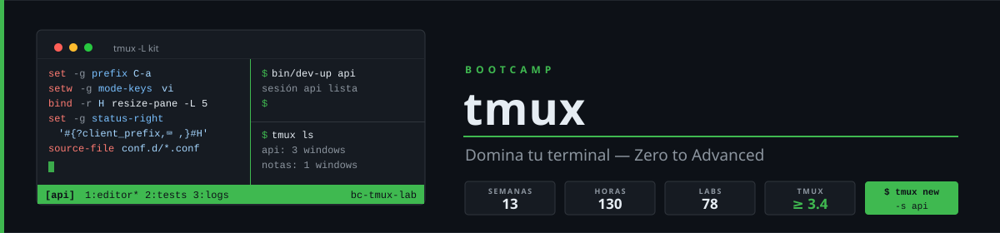

<p align="center">
  
</p>

<p align="center">
  <a href="LICENSE"></a>
  <a href="#"></a>
  <a href="#"></a>
  <a href="#"></a>
</p>

<p align="center">
  <a href="README.md"></a>
</p>

---

## 📋 Description

A **13-week (~3 months) Zero to Advanced** bootcamp on **tmux**, the terminal multiplexer. Self-paced, **10 h/week**, 100% hands-on: you start without ever having opened tmux and finish with your own configured, scriptable, reproducible work environment that runs locally, over SSH and in pair programming sessions.

> The course content is written in Spanish. This page is an English summary.

### 🎯 Goals

By the end of the bootcamp you will be able to:

- ✅ Explain the tmux server/client model and never lose work to a closed terminal or a dropped SSH connection
- ✅ Move fluently between sessions, windows and panes, and use `session:window.pane` targets
- ✅ Copy through copy-mode and buffers to the system clipboard, locally and over SSH (OSC 52)
- ✅ Write a modular configuration and understand server/session/window/pane option scopes
- ✅ Design your own key bindings and key tables, with navigation shared with Neovim
- ✅ Build your own status line with formats, conditionals and styles, without plugins
- ✅ Troubleshoot `TERM`, 24-bit color, undercurl and extended keys
- ✅ Automate project environments with idempotent scripts, hooks, popups and menus
- ✅ Use plugins with judgment and write your own
- ✅ Work with remote and nested tmux, and share sessions securely

---

## 🗓️ Structure

|        Phase           | Weeks | Hours | Main topics                                                   |
| :--------------------: | :---: | :---: | ------------------------------------------------------------- |
| **Fundamentals**       |  1-4  |  40h  | Server/client, windows, panes, sessions, copy mode            |
| **Configuration**      |  5-8  |  40h  | Options, key bindings, formats, status line, terminal & color |
| **Automation**         | 9-11  |  30h  | Scripting, hooks, popups, menus, plugins                      |
| **Advanced**           | 12-13 |  20h  | Remote, collaboration, control mode, capstone                 |

**Total: 13 weeks** | **130 hours** | Week index with status: [bootcamp/README.md](bootcamp/README.md)

### 🗺️ 13-Week Plan

| Week | Topic | Weekly project (`tmux-kit`) |
|------|-------|-----------------|
| 01 | First steps and the client-server model | `tmux-kit` with `bin/check-version` and `bin/kit-tree` |
| 02 | Windows and panes | Reproducible 3-pane work layout |
| 03 | Sessions, targets and sockets | Script to list and jump between sessions |
| 04 | Copy mode, buffers and clipboard | Clipboard working locally and over SSH |
| 05 | Configuration and option scopes | Modular `tmux.conf` + `conf.d/` with hot reload |
| 06 | Key bindings, key tables and navigation | Custom resize mode + Neovim navigation |
| 07 | Formats and the status line | Custom status line, no plugins |
| 08 | Terminal, color and debugging | Color/keys test suite + troubleshooting guide |
| 09 | Scripting tmux from the shell | Idempotent `bin/dev-up` |
| 10 | Hooks, popups and menus | Project picker popup + action menu + hooks |
| 11 | Plugins and ecosystem | Your own plugin + resurrect |
| 12 | Remote, collaboration and control mode | Secure pair programming + nested-tmux toggle |
| 13 | Capstone project | Final `tmux-kit` with `install.sh` |

Each week: minimal theory (≤ 45 min), 10 knowledge questions (15 min), 6 hands-on labs (6 h) and a weekly project (3 h). Assessment: Knowledge 30% / Performance 40% / Product 30%, with **at least 70% in each**.

---

## 🛠️ Tools

| Tool | Version | Use |
|------|---------|-----|
| Ubuntu | **24.04 LTS** (native or WSL2) or macOS | Minimum system |
| tmux | **≥ 3.4** | Core tool |
| Docker | Engine 27+ with Compose v2 | Lab and autograding |
| bash, jq, shellcheck, git | Ubuntu 24.04 versions | Scripts and autograding |
| fzf / Neovim / uv | ≥ 0.44 / ≥ 0.9 / 0.12.x | Weeks 10 / 06 / 11 (Python always via uv) |

Exact versions: [docs/stack-versions.md](docs/stack-versions.md).

## 🚀 Quick Start

```bash
git clone https://github.com/ergrato-dev/bc-tmux.git
cd bc-tmux
docker compose build
./scripts/verificar-semana.sh --doctor
```

---

## 📄 License

Licensed under **[CC BY-NC-SA 4.0](https://creativecommons.org/licenses/by-nc-sa/4.0/)**. See [LICENSE](LICENSE).

<p align="center">
  Made with ❤️ for the developer community
</p>
