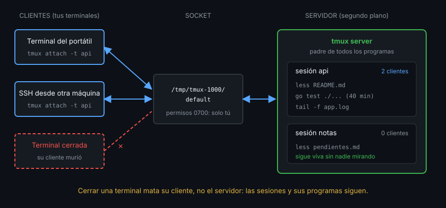
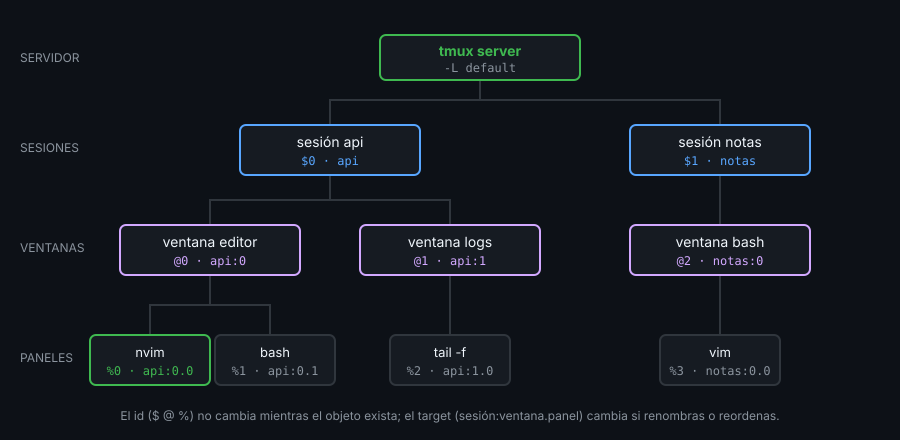

# Contexto — Qué es tmux y cómo funciona por dentro

## ¿Por qué importa esto?

Sin tmux, cada programa que lanzas en una terminal vive y muere con ella. Cierras la pestaña, se cae el Wi-Fi en mitad de un SSH o se reinicia el emulador, y la compilación de 40 minutos se pierde. tmux separa **lo que corre** de **la ventana desde la que lo miras**. Si entiendes ese modelo, todo lo demás del bootcamp (atajos, configuración, scripts, sesiones compartidas) es una consecuencia.

## Instalación y versión

Este bootcamp exige **tmux 3.4 o superior**, que es lo que trae Ubuntu 24.04:

```bash
tmux -V            # tmux 3.4
command -v tmux    # de dónde sale el binario
```

Ubuntu 22.04 trae 3.2a y no está soportado. Los pasos para cada sistema están en [docs/setup-entorno.md](../../../docs/setup-entorno.md). El laboratorio Docker siempre tiene 3.4.

## Servidor y clientes



- El **servidor** es un proceso en segundo plano. Guarda las sesiones y es el padre de todos los programas que corren dentro de tmux. Arranca solo la primera vez que creas una sesión y termina solo cuando no queda ninguna.
- Un **cliente** es tu terminal conectada a una sesión. Dibuja lo que el servidor le manda y le envía tus teclas. Puede haber varios clientes en la misma sesión.
- El **socket** es el archivo por el que hablan, en `/tmp/tmux-<UID>/default`. Con `-L nombre` usas otro socket y, por tanto, **otro servidor** completamente independiente. Así trabajan los labs (`-L lab`) y el autograding (`-L bc-check`) sin tocar tus sesiones.

Cerrar la terminal mata al **cliente**, no al servidor. Por eso el trabajo sobrevive: al volver con `attach`, un cliente nuevo se conecta a la misma sesión.

## Sesión, ventana y panel



| Objeto | Qué es | Id | Ejemplo de target |
|---|---|---|---|
| Sesión | Grupo de ventanas con nombre: un proyecto, una tarea | `$0` | `api` |
| Ventana | Una pantalla completa dentro de la sesión, como una pestaña | `@1` | `api:1` o `api:editor` |
| Panel | Un rectángulo dentro de la ventana con su propio programa | `%2` | `api:editor.0` |

Los nombres e índices puedes cambiarlos; los ids no cambian mientras el objeto exista. Por eso los scripts prefieren ids.

## Ejemplo mínimo

Pégalo en una terminal. No toca tus sesiones:

```bash
tmux -L demo new-session -d -s api -n editor     # arranca el servidor "demo"
tmux -L demo split-window -h -t api:editor       # segundo panel
tmux -L demo new-window -d -t api: -n logs       # segunda ventana
tmux -L demo list-panes -s -t api -F '#{session_id} #{window_id} #{pane_id} #{window_name}.#{pane_index}'
tmux -L demo display-message -p -t api '#{socket_path} pid=#{pid}'
tmux -L demo attach -t api                       # mira, y sal con Ctrl+b d
tmux -L demo kill-server
```

## Qué observar cuando lo ejecutes

- Los tres primeros comandos no te conectan: el servidor construye la sesión en segundo plano.
- `list-panes` imprime tres paneles con ids `%0`, `%1` y `%2`, repartidos en las ventanas `@0` y `@1`.
- `socket_path` termina en `/demo` y `pid` es el del servidor, no el de tu shell.
- Tras `Ctrl+b d`, `tmux -L demo ls` sigue mostrando la sesión: nadie la mira, pero sigue viva.

---
Sigue con [02-prefix-y-comandos.md](02-prefix-y-comandos.md).
