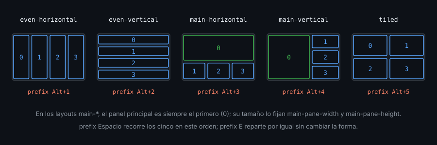
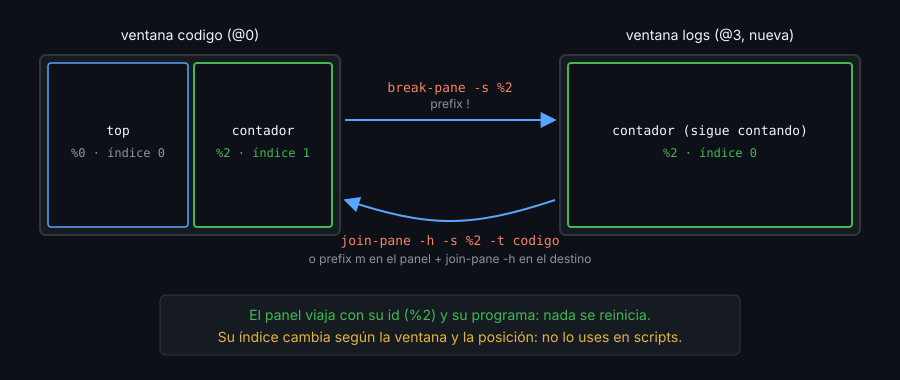

# Contexto — Layouts y reorganización

## ¿Por qué importa esto?

Partir paneles a mano produce repartos caprichosos: cada `split` divide solo el panel activo. Los **layouts** reparten la ventana entera con una regla, y sus variantes `main-*` dan el patrón más usado al programar: un panel grande y el resto apilado. Y cuando el reparto ya existe, mover paneles entre ventanas sin matar sus programas te ahorra relanzar servidores, tests o conexiones.

## Los cinco layouts



| Atajo | Layout |
|---|---|
| `prefix` `Alt`+`1` | `even-horizontal` |
| `prefix` `Alt`+`2` | `even-vertical` |
| `prefix` `Alt`+`3` | `main-horizontal` |
| `prefix` `Alt`+`4` | `main-vertical` |
| `prefix` `Alt`+`5` | `tiled` |
| `prefix` `Espacio` | Siguiente layout |
| `prefix` `E` | Reparte el espacio por igual sin cambiar la forma |

En los `main-*`, el principal es **el primer panel**. Su tamaño lo fijan las opciones de ventana `main-pane-width` y `main-pane-height`, en celdas o en porcentaje. Se leen **al aplicar** el layout: primero la opción, después `select-layout`.

```bash
tmux set -w main-pane-width 60%
tmux select-layout main-vertical
```

## Guardar un layout

Cualquier reparto, también uno hecho a mano, se lee como texto:

```bash
tmux display-message -p '#{window_layout}'
# b25f,80x24,0,0{40x24,0,0,0,39x24,41,0[39x11,41,0,1,39x12,41,12,2]}
```

Cuatro caracteres de suma de control, el tamaño total y, entre `{}` (columnas) o `[]` (filas), cada panel como `ANCHOxALTO,X,Y,ID`. `select-layout` con ese texto lo restaura, siempre que la ventana tenga **el mismo número de paneles**; tmux 3.4 no siempre avisa si no coincide.

Ojo al validar un target en un script: `display-message -p -t X` **no falla** si `X` no existe (usa otra ventana y sale con 0). `list-panes -t X` sí falla.

## Mover sin cerrar



| Atajo | Comando | Qué hace |
|---|---|---|
| `prefix` `!` | `break-pane` | Saca el panel a una ventana nueva |
| — | `join-pane -s ORIGEN -t DESTINO` | Mete un panel en otra ventana (`-h` al lado) |
| `prefix` `m` | `select-pane -m` | Marca un panel; `join-pane` sin `-s` usa el marcado |
| `prefix` `{` / `}` | `swap-pane -U` / `-D` | Intercambia con el panel anterior / siguiente |
| `prefix` `Ctrl`+`o` | `rotate-window` | Gira todos los paneles |
| `prefix` `.` | `move-window` | Mueve la ventana a otro índice |

## Escribir en varios paneles

`setw synchronize-panes on` envía lo que tecleas a todos los paneles de la ventana. Desde un script, recorre los ids con `send-keys -l -- "$texto"` y `Enter` aparte: `-l` impide que un texto como `C-c` se interprete como tecla.

## Qué observar

- Con 4 paneles, `prefix` `Espacio` recorre los cinco dibujos de arriba.
- Tras `join-pane`, `#{pane_id}` del panel movido es el mismo; `#{pane_index}`, no.
- Un `main-pane-width` puesto después de `select-layout` no cambia nada hasta el siguiente `select-layout`.

---
Listo. Ve al [lab-01](../2-practicas/lab-01-split-y-navegacion/README.md) y ponlo en práctica.

<!-- nav -->
---

## 🔗 Navegación

| Anterior | Siguiente |
|---|---|
| ← [Teoría — Contexto — Ventanas y paneles](01-ventanas-y-paneles.md) | [Índice de labs](../2-practicas/README.md) → |

[↑ Semana 02](../README.md)
