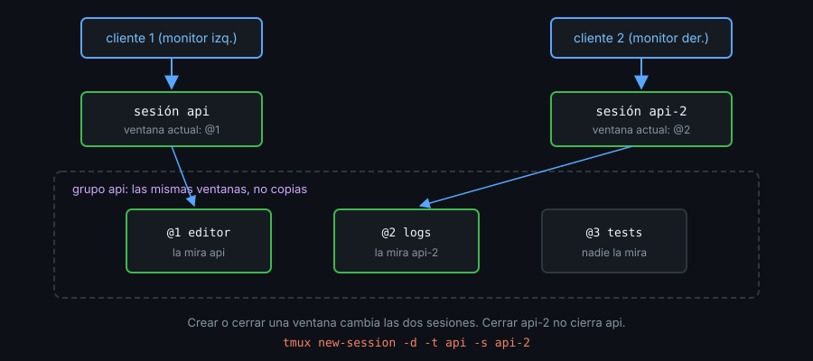

# Contexto — Varias sesiones y grupos

## ¿Por qué importa esto?

Una sesión es un espacio de trabajo completo: sus ventanas, sus directorios, sus programas corriendo. Con una sesión por proyecto, cambiar de proyecto es cambiar de sesión en dos teclas, y cada uno sigue exactamente donde lo dejaste. Eso funciona si sabes moverte entre ellas y apuntar a cada una sin equivocarte de nombre.

## Referencia rápida

| Atajo | Comando | Qué hace |
|---|---|---|
| `prefix` `s` | `choose-tree -Zs` | Árbol de sesiones con vista previa |
| `prefix` `w` | `choose-tree -Zw` | Árbol desplegado hasta las ventanas |
| `prefix` `(` / `)` | `switch-client -p` / `-n` | Sesión anterior / siguiente |
| `prefix` `L` | `switch-client -l` | Última sesión visitada |
| `prefix` `$` | `rename-session` | Renombra la sesión actual |
| `prefix` `D` | `choose-client -Z` | Elige qué cliente desconectar |
| — | `kill-session -t =api` | Cierra una sesión |

En el árbol: `Enter` salta, `x` cierra, `t` marca, `X` cierra los marcados, `f` filtra, `O` cambia el orden y `q` sale.

## Attach o switch-client

Un **cliente** es una terminal conectada al servidor y mirando una sesión.

- `attach-session` conecta un cliente **nuevo**. Es lo que haces desde una terminal fuera de tmux.
- `switch-client` cambia de sesión un cliente que ya existe. Es lo que haces **dentro** de tmux: un `attach` ahí metería un cliente dentro de un panel y tmux lo rechaza (`sessions should be nested with care`).

Un script que salta a una sesión mira `$TMUX` para elegir:

```bash
if [[ -n "${TMUX:-}" ]]; then
  tmux switch-client -t "=$name"
else
  tmux attach-session -t "=$name"
fi
```

Cuando cierras la sesión que estás mirando, `detach-on-destroy` decide: `on` (por defecto) desconecta tu cliente; `off` lo pasa a la sesión usada más recientemente.

```tmux
set -g detach-on-destroy off
```

## Grupos de sesiones

Dos clientes en la misma sesión ven siempre la misma ventana. Una sesión **agrupada** comparte las ventanas de otra pero tiene su propia ventana actual:

```bash
tmux new-session -d -t api -s api-2   # -t aquí es "agrúpate con api"
```



Crear o cerrar una ventana afecta a todo el grupo; cerrar una sesión del grupo no cierra las demás. Sirve para tener el mismo proyecto en dos monitores o para que dos personas trabajen en ventanas distintas del mismo proyecto.

## Ejemplo mínimo

```bash
tmux -L demo new-session -d -s api -n editor
tmux -L demo new-window -d -t api: -n logs
tmux -L demo new-session -d -t api -s api-2
tmux -L demo select-window -t api-2:logs
tmux -L demo ls -F '#{session_name} grupo=#{session_group} actual=#{window_name}'
tmux -L demo new-window -d -t api: -n tests
tmux -L demo list-windows -t api-2: -F '#{window_id} #{window_name}'
tmux -L demo kill-server
```

## Qué observar cuando lo ejecutes

- `api` sigue en `editor` y `api-2` está en `logs`: cada una con su ventana actual.
- Las dos dicen `grupo=api`.
- La ventana `tests`, creada en `api`, aparece en `api-2` con el mismo `@id`.

---
Sigue con [02-targets-y-sockets.md](02-targets-y-sockets.md).
