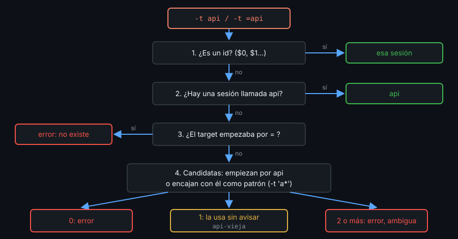

# Contexto — Targets y sockets

## ¿Por qué importa esto?

Casi todos los comandos de tmux llevan `-t`. Si el target es ambiguo, tmux no siempre se queja: elige algo y sigue. Un `kill-session -t api` que cierra `api-vieja` no da ningún error. Saber cómo resuelve tmux un target, y cómo pedirle el nombre exacto, es lo que separa un script fiable de uno que "casi siempre" funciona.

## La forma de un target

`sesión:ventana.panel`. Cada parte puede ser un nombre, un índice o un id, y lo que falta se completa con lo actual.

| Target | Apunta a |
|---|---|
| `api` / `api:` | Sesión `api` |
| `api:1` / `api:logs` | Ventana 1 / ventana `logs` de `api` |
| `api:logs.1` | Panel 1 de esa ventana |
| `$0` / `@3` / `%7` | Sesión / ventana / panel por id |
| `api:+` / `api:-` / `api:!` | Ventana siguiente / anterior / última |
| `{marked}` | El panel marcado (`prefix` `m`) |

Por eso `.` y `:` no pueden ir en un nombre de sesión: `tmux new -s web.app` crea `web_app` sin avisar.

## Cómo busca tmux una sesión



Sin `=`, si `api` no existe pero `api-vieja` sí, `-t api` encuentra `api-vieja`. En un script, **todo target de sesión lleva `=`**: `has-session -t "=$name"`.

Dos comandos se comportan distinto ante un target que no existe: `display-message -p -t X` usa otro objeto y sale con 0; `list-panes -t X` falla. Para validar, `list-panes` o `has-session`.

## Sockets

| Opción | Dónde queda el socket |
|---|---|
| (nada) | `/tmp/tmux-UID/default` |
| `-L nombre` | `/tmp/tmux-UID/nombre` (o `$TMUX_TMPDIR/tmux-UID/nombre`) |
| `-S ruta` | Exactamente en `ruta` |

El directorio `tmux-UID` es `0700`: solo tú entras. Si algo borra el socket, el servidor sigue vivo; `kill -USR1 PID_DEL_SERVIDOR` lo recrea.

## La variable TMUX

Dentro de cada panel, tmux define dos variables:

```bash
echo "$TMUX"        # /tmp/tmux-1000/lab,1234,0   socket,pid,sesión
echo "$TMUX_PANE"   # %3
```

`$TMUX` no vacío significa "estoy dentro de tmux", y el campo antes de la primera coma dice **en qué servidor**. Un script que habla con un servidor con `-L` y quiere saber si está dentro de ese mismo servidor compara las rutas:

```bash
[[ "${TMUX%%,*}" == "$(tmux -L lab display -p '#{socket_path}')" ]]
```

Para hablar con el servidor del panel, sea cual sea: `tmux -S "${TMUX%%,*}"`.

## Qué observar

- `tmux has-session -t api` con solo `api-2` creada sale con 0; con `-t =api`, con 1.
- Con `api-2` y `api-3`, `-t api` falla: el prefijo es ambiguo.
- `echo "$TMUX"` en paneles de dos servidores distintos muestra rutas distintas.

---
Listo. Ve al [lab-01](../2-practicas/lab-01-varias-sesiones/README.md) y ponlo en práctica.

<!-- nav -->
---

## 🔗 Navegación

| Anterior | Siguiente |
|---|---|
| ← [Teoría — Contexto — Varias sesiones y grupos](01-sesiones-y-grupos.md) | [Índice de labs](../2-practicas/README.md) → |

[↑ Semana 03](../README.md)
