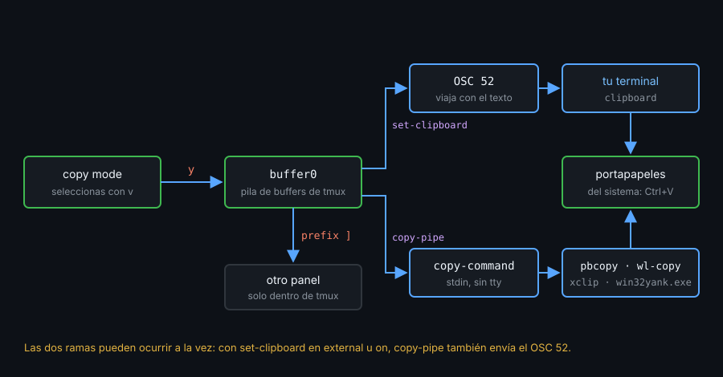
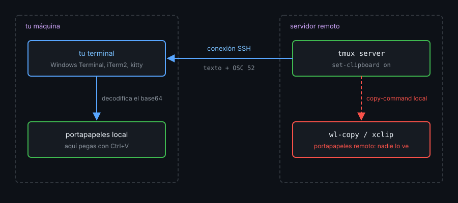

# Contexto — Portapapeles y OSC 52

## ¿Por qué importa esto?

Un buffer de tmux solo existe dentro del servidor: para pegarlo en el navegador tiene que llegar al portapapeles de tu sistema. Hay dos caminos, y elegir mal es la causa de casi todos los "copio en tmux y no pega": entregar el texto a una **herramienta del sistema** (`pbcopy`, `wl-copy`...) o pedirle a **tu terminal** que lo copie con una secuencia OSC 52. El primero falla por SSH; el segundo depende de la terminal y de la configuración de tmux.



## copy-command

`copy-pipe` envía la selección por la entrada estándar de un comando. Sin argumento, usa la opción de servidor `copy-command`, y así una sola línea vale para `y`, `Enter` y soltar el ratón:

```tmux
set -s copy-command 'wl-copy'
bind -T copy-mode-vi y send -X copy-pipe-and-cancel
```

| Sistema | Herramienta | Ojo con |
|---|---|---|
| macOS | `pbcopy` | Nada: viene instalada |
| WSL | `clip.exe` | Rompe la ñ y las tildes: mejor `win32yank.exe -i` |
| Wayland | `wl-copy` | Paquete `wl-clipboard` |
| X11 | `xclip -selection clipboard` | Sin `-selection clipboard` va a PRIMARY (botón central) |

El comando lo lanza el servidor **sin terminal** (`/dev/tty` no existe para él) y **desde tu `$HOME`**: usa rutas absolutas. Dentro de un `tmux.conf`, `set -sF ... "#{d:current_file}/bin/..."` construye la ruta desde el propio archivo, que es absoluta si lo cargaste con una ruta absoluta (`-f "$PWD/tmux.conf"`).

## OSC 52

Una terminal que soporta OSC 52 copia al portapapeles lo que reciba así:

```bash
printf '\033]52;c;%s\a' "$(printf hola | base64 | tr -d '\n')"
```

Viaja por el mismo canal que el texto, así que **atraviesa SSH**: el portapapeles que se llena es el de la máquina donde está tu terminal.



tmux decide si la envía con dos piezas:

| Pieza | Valor | Efecto |
|---|---|---|
| `set-clipboard` | `off` | Nunca |
| | `external` (por defecto) | Al copiar en copy mode; los programas del panel no pueden |
| | `on` | Además, acepta OSC 52 de los programas del panel (un editor o un script por SSH) |
| `terminal-features` | `clipboard` | Tu terminal la soporta. Viene para `xterm*`; si tu `TERM` es otro, añádela |

```tmux
set -s set-clipboard on
set -as terminal-features ',xterm-kitty:clipboard'
```

`-a` añade: sin él, el `set` sustituye toda la lista por defecto. La receta de la secuencia es la capacidad `Ms` de terminfo, que tmux toma del terminfo de tu terminal o de la feature `clipboard`. Para ver si la tiene, con un cliente conectado: `tmux show-messages -T | grep ' Ms:'`. Si dice `[missing]`, tmux no envía nada.

Un script lanzado por tmux (`copy-pipe`, `run-shell`) no tiene tty donde escribir el OSC 52. Le pide a tmux que lo envíe:

```bash
printf hola | tmux load-buffer -w -    # buffer nuevo + OSC 52 a la terminal exterior
```

## Qué observar

- `tmux show -sv set-clipboard` imprime `external` si no lo cambiaste.
- `tmux display -p '#{client_termfeatures}'` incluye `clipboard` en Windows Terminal, iTerm2, kitty o WezTerm.
- Algunas terminales piden permiso para OSC 52 (iTerm2: *Applications in terminal may access clipboard*).

---
Listo. Ve al [lab-01](../2-practicas/lab-01-moverte-por-el-historial/README.md) y ponlo en práctica.

<!-- nav -->
---

## 🔗 Navegación

| Anterior | Siguiente |
|---|---|
| ← [Teoría — Contexto — Copy mode y buffers](01-copy-mode-y-buffers.md) | [Índice de labs](../2-practicas/README.md) → |

[↑ Semana 04](../README.md)
