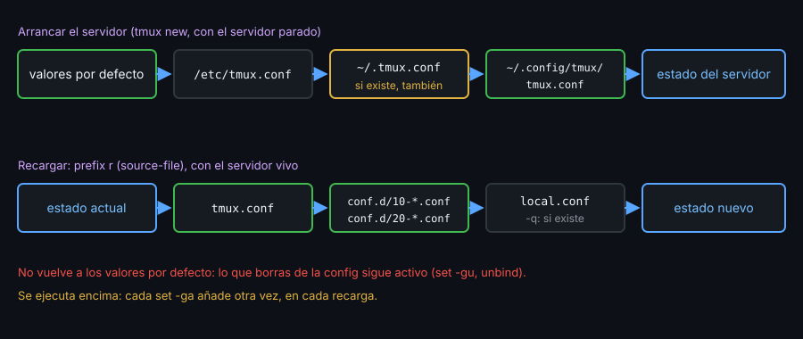

# Contexto — Dónde vive la config y cómo se recarga

## ¿Por qué importa esto?

Hasta ahora tu config cabía en un archivo y la probabas con `tmux -L lab -f starter/tmux.conf`. A partir de esta semana es tu entorno diario: tiene que cargar igual en cualquier máquina, recargarse sin cerrar nada y crecer en módulos sin volverse un archivo de 300 líneas. Para eso necesitas saber qué archivos lee tmux, cuándo los lee y qué no deshace una recarga.

## Qué archivos lee, y cuándo

Al **arrancar el servidor** (no al conectar un cliente), tmux carga, en este orden, **todos** los que existan:

| Orden | Archivo |
|:--:|---|
| 1 | `/etc/tmux.conf` |
| 2 | `~/.tmux.conf` (el de siempre) |
| 3 | `$XDG_CONFIG_HOME/tmux/tmux.conf`, si la variable está definida |
| 4 | `~/.config/tmux/tmux.conf` |

Si tienes un `~/.tmux.conf` olvidado, se carga **antes** que el de `~/.config/tmux/` y lo que no pises sigue activo. `tmux display -p '#{config_files}'` dice cuáles cargó. `-f archivo` sustituye la lista entera; `-f /dev/null` arranca sin config.

Editar el archivo no cambia nada mientras el servidor siga vivo: o recargas con `source-file`, o cierras el servidor.

## Errores

Una línea con error no detiene el archivo: tmux sigue con la siguiente. Al arrancar, avisa por stderr con `archivo:línea`, pero sale con 0; si tmux lo lanza un atajo de tu terminal, el aviso no lo lee nadie. Para depurar, desde fuera y con un servidor aparte:

```bash
tmux -L demo -f /dev/null new -d
tmux -L demo source-file ~/.config/tmux/tmux.conf     # errores, y sale con 1
tmux -L demo source-file -n ~/.config/tmux/tmux.conf  # solo analiza la sintaxis
tmux -L demo source-file -v ~/.config/tmux/tmux.conf  # muestra archivo:línea de cada comando
tmux -L demo kill-server
```

## Recargar



```tmux
bind r source-file -F "#{@kit-dir}/tmux.conf" \; display "config recargada"
```

`source-file` ejecuta el archivo **encima** del estado actual. Dos consecuencias:

- Lo que **borras** de la config sigue activo hasta que lo deshagas: `set -gu opcion` (vuelve al valor por defecto), `unbind tecla`, o reiniciar el servidor.
- Lo que **añades** con `-a` se añade otra vez en cada recarga. `set -ga update-environment WAYLAND_DISPLAY` tras tres recargas deja tres copias. Una línea de config tiene que dar el mismo resultado la primera vez y la décima: `set -gu` antes de `set -ga`, o un valor completo con `set -g`.

## Config modular

```tmux
# tmux.conf: solo el punto de entrada
set -gF @kit-dir "#{d:current_file}"
source-file -F "#{@kit-dir}/conf.d/*.conf"
source-file -qF "#{@kit-dir}/local.conf"
```

- `current_file` es el archivo que se está leyendo; `d:` se queda con el directorio. Solo existe **mientras** se lee: `set -gF` lo copia en `@kit-dir` para usarlo después (la tecla `r`, `copy-command`).
- `source-file conf.d/*.conf`, sin ruta absoluta, se resuelve desde el directorio en el que arrancaste tmux: funciona en tu repositorio y falla en cualquier otro sitio.
- El glob se ordena por nombre: `05-` antes que `10-`, pero `5-` **después** de `40-`. Usa siempre dos cifras.
- `-q` no se queja si no hay coincidencias: `local.conf`, fuera de git, guarda lo propio de cada máquina.

Para una opción que solo existe en versiones nuevas, un bloque condicional se evalúa al leer el archivo, sin lanzar una shell:

```tmux
%if "#{>=:#{version},3.5}"
set -g @kit-moderno on
%endif
```

## Qué observar

- Con `~/.tmux.conf` y `~/.config/tmux/tmux.conf` a la vez, `#{config_files}` muestra los dos.
- `source-file` dos veces seguidas no debería cambiar `tmux show -g`.
- `tmux -L x -f conf.d/../tmux.conf` funciona en el repositorio; `cd /` y lo mismo, ¿también?

---
Listo. Ve al [lab-01](../2-practicas/lab-01-donde-vive-la-config/README.md) y ponlo en práctica.
