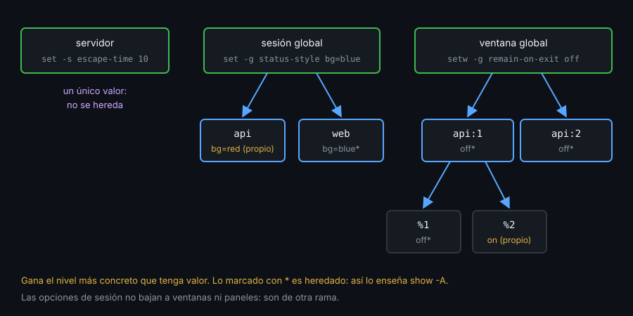

# Contexto — Alcances de las opciones

## ¿Por qué importa esto?

`set -g status-style bg=red` pinta todas las sesiones; `set status-style bg=red` solo la actual, y en un `tmux.conf` cargado al arrancar no pinta ninguna, sin dar error. Cada opción vive en un nivel concreto y se hereda hacia abajo. Si no sabes en qué nivel está un valor, no sabes por qué un panel se ve distinto ni cuál de tus líneas está ganando.

## Los niveles

| Nivel | Flag | Ejemplos | Hereda de |
|---|---|---|---|
| Servidor | `-s` | `escape-time`, `set-clipboard`, `copy-command` | Nadie: un único valor |
| Sesión | `-t sesión` | `prefix`, `base-index`, `status`, `mouse` | Sesión global (`-g`) |
| Ventana | `-w -t ventana` | `mode-keys`, `automatic-rename`, `pane-base-index` | Ventana global (`-gw`) |
| Panel | `-p -t panel` | `remain-on-exit`, `window-style` | Su ventana |



Una opción de ventana se puede fijar en un panel solo si tmux la marca como de panel (`remain-on-exit`, `window-style`, `window-active-style`...). Las de sesión no bajan a las ventanas: `prefix` es de sesión y vale igual en todas sus ventanas.

## Fijar y quitar

```bash
tmux -L demo -f /dev/null new -d -s api -n editor
tmux -L demo split-window -d -t api:editor
tmux -L demo set -s escape-time 10                         # servidor
tmux -L demo set -g status-style bg=blue                   # todas las sesiones
tmux -L demo set -t api status-style bg=red                # solo api
tmux -L demo set -gw mode-keys vi                          # todas las ventanas
tmux -L demo set -p -t api:editor.1 window-style bg=colour52   # un panel
tmux -L demo set -u -t api status-style                    # api vuelve a heredar
tmux -L demo kill-server
```

`setw` es `set -w`. `-u` quita el valor de ese nivel y vuelve a heredar; `-gu` devuelve el global a su valor por defecto. `-a` añade al final (una cadena o una lista), `-o` solo fija si no había valor, `-F` expande un formato antes de guardar.

## Preguntar

| Comando | Qué muestra |
|---|---|
| `show -s` | Opciones del servidor |
| `show -g` / `show -gw` | Globales de sesión / de ventana |
| `show -t api` | Lo fijado **en** la sesión `api`, sin herencia |
| `show -A -t api` | Lo fijado y lo heredado; lo heredado lleva `*` |
| `show -pv -t api:editor.1 window-style` | Solo el valor |

Dos trampas:

- **Con el nombre de una opción, tmux elige el alcance por su cuenta.** Si `api` tiene su propio `status-style`, `show -p -t api:editor.0 status-style` lo muestra, aunque pidas `-p`. Para saber en qué nivel está fijada, lista el nivel **sin nombre** (`show -p -t panel`) y busca la opción en la lista.
- **`set` sin `-g` actúa sobre la sesión actual.** Desde un panel, es la tuya. En un `tmux.conf` leído al arrancar todavía no hay sesión: falla con `no current session` y nadie lo ve. En la config, `-g` siempre.

## Opciones de usuario

Las que empiezan por `@` no hacen nada por sí solas: guardan datos que lees con formatos. En el kit, el prefijo `@kit-`:

```tmux
set -gF @kit-dir "#{d:current_file}"
```

## Qué observar

- `tmux show -A -t api` marca con `*` lo que la sesión hereda.
- Tras `set -u -t api status-style`, la sesión vuelve al azul global.
- `tmux show -p -t api:editor.0` no lista nada aunque el panel tenga el `mode-keys` de su ventana.

---
Listo. Ve al [lab-01](../2-practicas/lab-01-donde-vive-la-config/README.md) y ponlo en práctica.

<!-- nav -->
---

## 🔗 Navegación

| Anterior | Siguiente |
|---|---|
| ← [Teoría — Contexto — Dónde vive la config y cómo se recarga](01-config-y-recarga.md) | [Índice de labs](../2-practicas/README.md) → |

[↑ Semana 05](../README.md)
