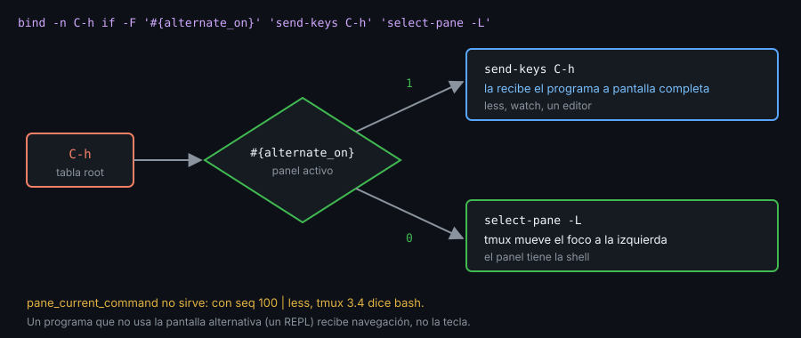

# Contexto — Teclas que deciden: navegación entre paneles y programas

## ¿Por qué importa esto?

Cambiar de panel es lo que más haces, y `prefix` + flecha son dos pulsaciones. `bind -n C-h select-pane -L` lo deja en una, pero `C-h` ya no llega a ningún programa: `less`, `watch` o tu editor la pierden. La salida es una tecla que pregunta antes de actuar: si el panel tiene un programa a pantalla completa, le pasa la tecla; si tiene la shell, mueve el foco. tmux lo decide con un format, sin plugins y sin saber qué programa usas.

## `if -F`: decidir sin lanzar una shell

```tmux
bind -n C-h if -F '#{alternate_on}' 'send-keys C-h' 'select-pane -L'
```

`-F` evalúa el format: vacío o `0` es falso, cualquier otra cosa es verdadero. Sin `-F`, `if` lanza `sh -c` en cada pulsación: más lento y dependiente del `PATH`. Si las ramas llevan comillas, usa bloques: `if -F '#{selection_present}' { send -X copy-selection-and-cancel } { send -X cancel }`.

| Format | Vale 1 cuando |
|---|---|
| `#{alternate_on}` | El panel está en la pantalla alternativa: `less`, `watch`, un editor (`top` de procps no la usa) |
| `#{pane_in_mode}` | El panel está en copy mode u otro modo |
| `#{selection_present}` | Hay texto seleccionado en copy mode |
| `#{window_zoomed_flag}` | La ventana tiene un panel con zoom |

## Por qué `alternate_on` y no el nombre del programa



Los programas a pantalla completa piden a la terminal la **pantalla alternativa**: la que desaparece al salir y deja intacto lo que había antes. tmux lo sabe en cada panel. `#{pane_current_command}` parece más directo y falla: con `seq 100 | less`, tmux 3.4 dice `bash` mientras `alternate_on` vale 1. Además, una lista de nombres hay que mantenerla con cada programa nuevo; `alternate_on` funciona con cualquiera.

El límite: un programa que no usa la pantalla alternativa (un REPL como `python3`) recibe navegación en lugar de la tecla.

## El coste

- `C-l` limpia la pantalla de la shell; ahora mueve el foco a la derecha. Recupéralo con `bind C-l send-keys C-l`: `prefix` `C-l` limpia.
- Si tu terminal envía `C-h` al pulsar Backspace (`cat -v` muestra `^H`), robar `C-h` rompe el borrado. El lab-05 lo comprueba.
- Una tecla de `root` vale en todos los paneles de todas las sesiones. Antes de añadir una, `list-keys -T root tecla` te dice si ya está ocupada.

## Ejemplo mínimo funcional

```bash
tmux -L demo -f /dev/null new -d -s nav \; split-window -h
tmux -L demo bind -n C-h if -F '#{alternate_on}' 'send-keys C-h' 'select-pane -L'
tmux -L demo bind -n C-l if -F '#{alternate_on}' 'send-keys C-l' 'select-pane -R'
tmux -L demo bind C-l send-keys C-l
tmux -L demo send-keys -t nav:0.0 'seq 100 | less' Enter
sleep 1
tmux -L demo display -p -t nav:0.0 'alt=#{alternate_on} cmd=#{pane_current_command}'
tmux -L demo display -p -t nav:0.1 'alt=#{alternate_on} cmd=#{pane_current_command}'
tmux -L demo attach -t nav
```

Al terminar, desde otra terminal: `tmux -L demo kill-server`.

## Qué observar

- Los dos `display` imprimen `alt=1 cmd=bash` y `alt=0 cmd=bash`: el nombre del programa no distingue los paneles; `alternate_on` sí.
- Desde el panel derecho, `C-h` te lleva a `less`. Ahí `C-l` no mueve el foco: `less` la recibe y redibuja.
- Sal de `less` con `q` y pulsa `C-l`: ahora sí pasas al panel derecho.
- En la shell, `prefix` `C-l` limpia la pantalla.

---
Listo. Ve al [lab-01](../2-practicas/lab-01-bind-unbind-y-list-keys/README.md) y ponlo en práctica.

<!-- nav -->
---

## 🔗 Navegación

| Anterior | Siguiente |
|---|---|
| ← [Teoría — Contexto — Tablas de teclas y bindings](01-tablas-y-bindings.md) | [Índice de labs](../2-practicas/README.md) → |

[↑ Semana 06](../README.md)
