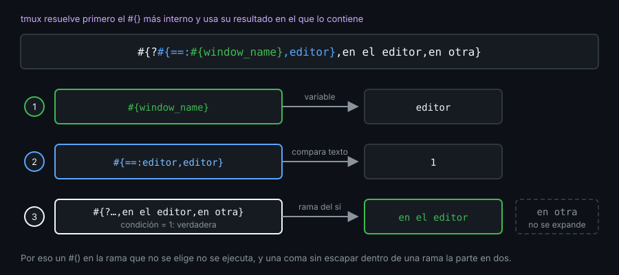

# Contexto — Formats

## ¿Por qué importa esto?

Todo lo que tmux sabe de sí mismo (sesión, ventana, panel, cliente, tabla activa, zoom) está disponible como format: `#{session_name}`, `#{window_zoomed_flag}`, `#{client_key_table}`. Con ellos se escriben la status line, los `list-* -F` de tus scripts y los `if -F` de la semana 06. Un format mal escrito no da error: sale vacío o con texto de más. Si lo pruebas con `display -p` antes de meterlo en la barra, no recargas a ciegas.

## Cómo se expande

tmux resuelve primero los `#{}` más internos y usa su resultado como texto del que los contiene. Un condicional solo expande la rama elegida.



## Referencia rápida

Ejemplos con la sesión `api`, ventanas `editor` (actual) y `logs`:

| Format | Qué hace | Resultado |
|---|---|---|
| `#{session_name}` · `#{@x}` | Variable u opción | `api` |
| `#{?window_active,*,-}` | Condicional: verdadero si no es vacío ni `0` | `*` |
| `#{==:#{window_name},editor}` | Compara texto (`!=`, `<`, `>`): `1` o `0` | `1` |
| `#{m:a*,#{session_name}}` | Patrón de shell (`m/r:` regex, `m/i:` sin mayúsculas) | `1` |
| `#{&&:1,0}` · `#{\|\|:0,1}` | Y · O | `0` · `1` |
| `#{e\|*\|:#{session_windows},10}` | Aritmética y comparación numérica | `20` |
| `#{=2:session_name}` · `#{=-2:session_name}` | Primeros · últimos N caracteres | `ap` · `pi` |
| `#{p6:session_name}` | Rellena hasta 6 (`p-6` a la izquierda) | `api   ` |
| `#{s/a/A/:session_name}` | Sustituye (expresión regular) | `Api` |
| `#{b:@path}` · `#{d:@path}` | Basename · dirname | `main.go` · `/srv/api` |
| `#{t:session_created}` | Fecha legible de un timestamp | `Mon Nov  2 10:14:03 2026` |
| `#{q:pane_current_path}` | Escapa para la shell (en `/srv/mi api`) | `/srv/mi\ api` |
| `#{E:status-left}` | Expande el valor de una opción como format | `[api] ` |
| `#{W:#{window_name} }` | Repite por ventana (`S:` sesión, `P:` panel) | `editor logs ` |
| `##` · `#,` · `#}` | `#`, coma y llave literales | `#` · `,` · `}` |

Trampas que no avisan:

- Lo que no existe se expande a vacío, sin error: `#{sesion_name}` y `#{@nada}` no imprimen nada.
- `#{<:10,9}` vale `1` porque compara texto. Para números: `#{e|<|:10,9}` vale `0`.
- `e|` no resuelve nombres de opción: `#{e|*|:#{@n},2}`, no `#{e|*|:@n,2}`.
- En 3.4 no hay `#{!:...}`. Para negar: `#{?cond,0,1}` o `#{==:#{cond},0}`.
- Una coma dentro de una rama corta la rama: `#{?session_name,a,b,c}` da `a`; `#{?session_name,a#,b,c}` da `a,b`.
- La condición es un nombre, no un valor: `#{?1,a,b}` da `b`, porque no existe ninguna variable `1`.
- `set -g @y '#{session_name}'` guarda el texto tal cual y se expande cada vez que se usa con `E:`; con `set -gF` se expande una sola vez, al ejecutar `set`.

## Ejemplo mínimo funcional

```bash
tmux -L demo -f /dev/null new -d -s api -n editor \; neww -d -n logs
tmux -L demo set -g @path /srv/api/main.go
tmux -L demo display -p '#{session_name} tiene #{session_windows} ventanas'
tmux -L demo display -p '#{?#{==:#{window_name},editor},en el editor,en otra}'
tmux -L demo display -p '#{b:@path} en #{d:@path} | #{=2:session_name}|#{p6:session_name}|'
tmux -L demo display -p 'texto #{<:10,9} | número #{e|<|:10,9}'
tmux -L demo display -p '#{W:#{window_index}:#{window_name} }'
tmux -L demo display -p '[#{sesion_name}] [#{?session_name,a#,b,c}] [##{x}]'
tmux -L demo list-windows -F '#{window_index} #{window_name} #{?window_active,*,-}'
tmux -L demo kill-server
```

## Qué observar

- `api tiene 2 ventanas` y `en el editor`: `neww -d` crea `logs` sin cambiar la ventana actual.
- `main.go en /srv/api | ap|api   |`: los modificadores trabajan sobre el valor, no sobre el nombre.
- `texto 1 | número 0`: la misma comparación da resultados opuestos.
- `[] [a,b] [#{x}]`: un nombre mal escrito no avisa, `#,` y `##` escapan.
- `list-windows -F` imprime una línea por ventana (`0 editor *`, `1 logs -`): así leerán tmux tus scripts.

---
Listo. Ve al [lab-01](../2-practicas/lab-01-formats-y-display/README.md) y ponlo en práctica.
