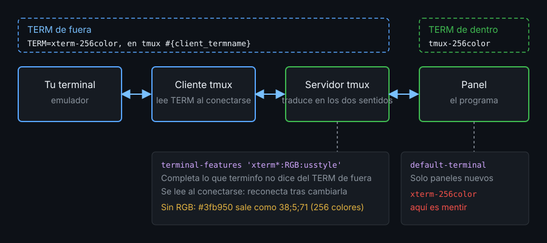

# Contexto — Terminal y color

## ¿Por qué importa esto?

Colores lavados, subrayado ondulado que sale recto, `Esc` que tarda medio segundo, `C-Enter` que llega como `Enter`: casi nunca es culpa del programa. tmux está entre tu terminal y el programa, y traduce en las dos direcciones. Si no le dices qué sabe hacer tu terminal, se queda con lo mínimo que promete terminfo, sin avisar. Si le mientes al programa sobre qué terminal tiene delante, el programa manda secuencias que tmux no entiende.

## Dos TERM, dos trabajos



- **Fuera**: tu emulador pone `TERM` (casi siempre `xterm-256color`). El cliente lo lee al conectarse y tmux busca esa entrada en terminfo para saber cómo hablarle. Si la entrada no existe, no te conectas: `missing or unsuitable terminal`.
- **Dentro**: cada panel nace con `TERM` = `default-terminal`, que en 3.4 ya vale `tmux-256color`. Describe a tmux, no a tu terminal. Ponerle `xterm-256color` es mentir: Inicio y Fin, cursiva o colores de fondo fallan en algunos programas.
- **Lo que terminfo no sabe**: la entrada `xterm-256color` no declara color de 24 bits ni subrayado ondulado, aunque tu terminal los tenga. `terminal-features` añade capacidades al TERM de fuera, por patrón. `terminal-overrides` (con `Tc`) es la forma antigua.

Sin la feature `RGB`, tmux convierte `#3fb950` al índice 256 más cercano (`38;5;71`): parecido, no igual. Sin `usstyle`, `\e[4:3m` se queda en `\e[4m`.

## Referencia rápida

| Pieza | Qué hace |
|---|---|
| `#{client_termname}` | El TERM de fuera de ese cliente |
| `#{client_termfeatures}` | Las features que tmux usa con ese cliente |
| `set -s default-terminal tmux-256color` | TERM de dentro (paneles nuevos) |
| `set -su terminal-features` | Vuelve a las tres entradas de fábrica |
| `set -sa terminal-features 'xterm*:RGB:usstyle:extkeys'` | Añade features a las terminales `xterm*` |
| `RGB` · `usstyle` · `extkeys` · `clipboard` | 24 bits · estilos de subrayado · teclas extendidas · OSC 52 |
| `set -s extended-keys on` | Entrega teclas como `C-Enter` a los programas que las piden |
| `set -s escape-time 10` | Milisegundos que espera tras `Esc` (500 de serie) |
| `setw -g allow-passthrough on` | Deja pasar `\ePtmux;...\e\\` del panel visible a tu terminal |
| `infocmp -x tmux-256color` | Capacidades de una entrada terminfo |

Reglas que no avisan:

- Las features se leen al conectarse: tras cambiarlas, desconéctate y vuelve.
- `set -sa` en cada recarga duplica la entrada; `-u` antes de `-a` lo hace idempotente.
- Una feature o un patrón mal escritos se aceptan sin error: compruébalos en `#{client_termfeatures}`.
- `allow-passthrough` deja que cualquier programa del panel hable con tu terminal sin filtro: `on`, nunca `all` sin motivo.

## Ejemplo mínimo funcional

```bash
cat > /tmp/demo.conf <<'EOF'
set -s  default-terminal tmux-256color
set -su terminal-features
set -sa terminal-features 'xterm*:RGB:usstyle:extkeys'
set -s  extended-keys on
set -s  escape-time 10
set -s  focus-events on
setw -g allow-passthrough on
EOF
tmux -L demo -f /tmp/demo.conf new -s demo
```

Dentro del panel:

```bash
echo "$TERM"
printf '\e[38;2;255;100;0m24 bits\e[0m  \e[4:3mondulado\e[0m\n'
```

Desde otra terminal:

```bash
tmux -L demo display -p '#{client_termname} | #{client_termfeatures}'
tmux -L demo source-file /tmp/demo.conf; tmux -L demo show -s terminal-features
tmux -L demo kill-server
```

## Qué observar

- Dentro, `$TERM` es `tmux-256color`; fuera, `client_termname` es el de tu terminal.
- `client_termfeatures` incluye `RGB`, `usstyle` y `extkeys`, que terminfo no declara.
- Recargar dos veces deja cuatro entradas en `terminal-features`, no cinco ni seis.
- El naranja y el ondulado se ven si tu terminal los soporta; si no, tmux ya los mandó bien y es tu emulador quien los ignora.

---
Listo. Ve al [lab-01](../2-practicas/lab-01-dos-term/README.md) y ponlo en práctica.

<!-- nav -->
---

## 🔗 Navegación

| Anterior | Siguiente |
|---|---|
| ← [Semana 08 — Terminal, color y depuración](../README.md) | [Teoría — Contexto — Depuración](02-depuracion.md) → |

[↑ Semana 08](../README.md)
