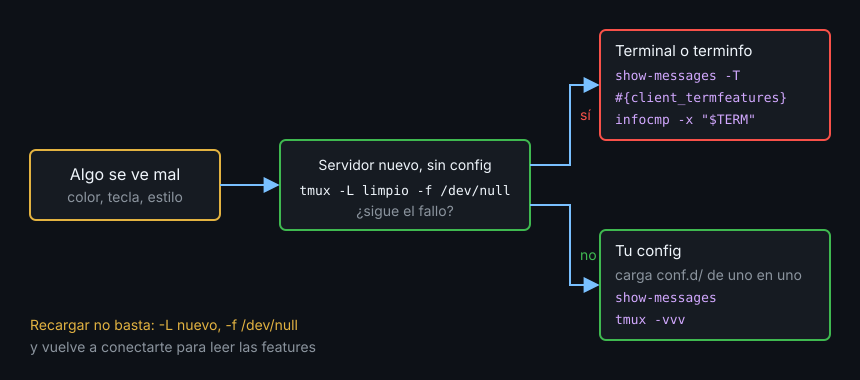

# Contexto — Depuración

## ¿Por qué importa esto?

Cuando algo se ve mal dentro de tmux hay tres sospechosos: tu config, tmux y tu terminal. Cambiar opciones al azar y recargar no sirve: hay opciones que no se borran al recargar y features que solo se leen al conectarse, así que puedes arreglarlo sin enterarte o creer que lo arreglaste. Depurar es aislar primero y preguntar después.

## Aislar: ¿config o terminal?



Un servidor nuevo, en otro socket y sin config (`tmux -L limpio -f /dev/null`), te da tmux de fábrica sin tocar tu sesión. Recargar en el servidor de siempre no vale: `terminal-overrides` y otras opciones de servidor se quedan como estaban hasta `set -su` o hasta reiniciar.

## Referencia rápida

| Comando | Qué te dice | Necesita |
|---|---|---|
| `tmux -V` · `display -p '#{version}'` | Versión del cliente · del servidor | — |
| `display -p '#{client_termname}'` | TERM de fuera del cliente | un cliente conectado |
| `display -p '#{client_termfeatures}'` | Features activas de ese cliente | un cliente conectado |
| `show-messages -T -t CLIENTE` | Cada capacidad terminfo que tmux usa con ese cliente (`[missing]` si falta) | un cliente |
| `show-messages -t CLIENTE` | Últimos comandos y mensajes, también los errores | un cliente |
| `show -s` · `show -g` · `show -gw` | Opciones de servidor, sesión y ventana como quedaron | servidor |
| `tmux -vvv -L x ...` | Logs `tmux-server-PID.log` y `tmux-client-PID.log` en el directorio actual | cwd escribible |
| `infocmp -x NOMBRE` | Si la entrada terminfo existe y qué declara | — |

Reglas que no avisan:

- Sin cliente conectado, `show-messages` e `info` fallan con `no current client`, y los `client_*` salen vacíos.
- `-vvv` escribe los logs donde estás. En un directorio sin permiso de escritura sale con 0 y no deja nada: trabaja en `/tmp`.
- `-vvv` solo en el `attach` no registra el servidor, que ya estaba arrancado: ponlo en el comando que lo arranca.
- El log del servidor tiene miles de líneas: busca, no leas. `IDENTIFY_TERM` es el TERM de fuera de cada cliente; `spawn_pane: environment TERM=` el de dentro de cada panel.

## Ejemplo mínimo funcional

```bash
mkdir -p /tmp/logs && cd /tmp/logs
tmux -vvv -L demo -f /dev/null new -d -s demo
ls tmux-*.log
grep -m2 -hE 'IDENTIFY_TERM|spawn_pane: environment TERM' tmux-server-*.log
tmux -L demo show -sv escape-time
tmux -L demo show -sv extended-keys
tmux -L demo show-messages -T
```

Ahora conéctate desde otra terminal con `tmux -L demo attach` y, de vuelta en la primera:

```bash
c=$(tmux -L demo list-clients -F '#{client_name}' | head -1)
tmux -L demo show-messages -T -t "$c" | grep -E ' (colors|RGB|Tc|Smulx):'
tmux -L demo kill-server
```

## Qué observar

- Quedan tres archivos: `tmux-client-*`, `tmux-server-*` y un `tmux-out-*` vacío.
- El `grep` enseña los dos TERM: el de fuera que mandó el cliente y el `tmux-256color` del panel.
- De fábrica, `escape-time` es `500` y `extended-keys` `off`: dos causas clásicas de `Esc` lento y `C-Enter` perdida.
- `show-messages -T` sin cliente falla; con cliente lista `colors: (number) 256` y `RGB: [missing]` con la config vacía.

---
Listo. Ve al [lab-06](../2-practicas/lab-06-depurar-una-terminal-rota/README.md) y ponlo en práctica.
