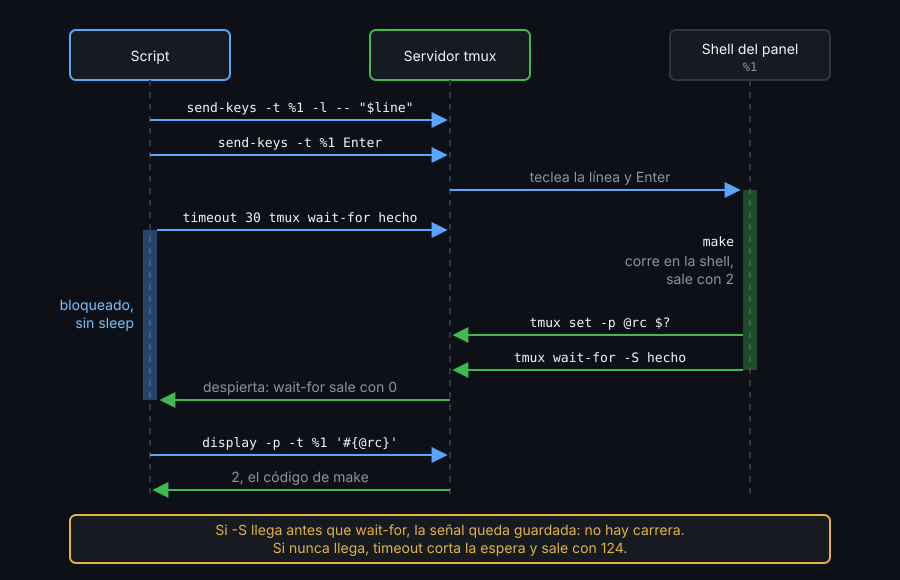
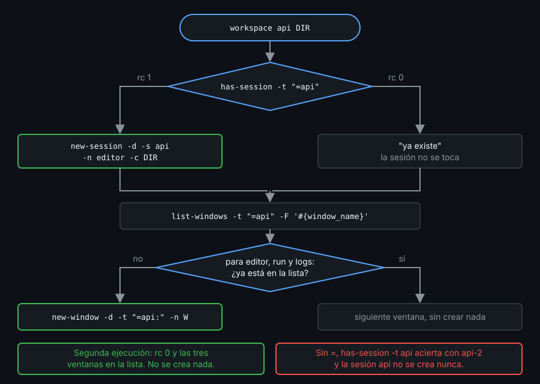

# Contexto — Teclas, esperas e idempotencia

## ¿Por qué importa esto?

Lo difícil viene después de crear: teclear un comando sin que un nombre de archivo raro ejecute otra cosa, saber cuándo ha terminado sin un `sleep 5` a ojo y relanzar el script sin acabar con diez ventanas `logs`. Los tres fallos son silenciosos.

## Enviar teclas

`send-keys` teclea en el panel. Sin `-l`, un argumento que sea exactamente un nombre de tecla (`Enter`, `C-c`) se pulsa; el resto va como texto, y los argumentos se pegan sin espacio.

- **`-l`** manda el texto tal cual, también `C-c` o `Enter` como letras. El `Enter` va aparte, sin `-l`. `--` protege un texto que empiece por `-`.
- La shell del panel **sí** interpreta lo que tecleas: un nombre externo (`notas;date.txt`) se escapa con `%q`, o el `;` ejecuta lo que siga.
- En un panel ocupado, lo tecleado espera. `respawn-pane -k` mata lo que corre y arranca una shell nueva en el mismo `%id`.
- El comando de `new-window 'cmd'` es otra cosa: es el proceso del panel, y al terminar cierra la ventana salvo con `remain-on-exit on`.

## Esperar



`wait-for CANAL` bloquea hasta que alguien ejecuta `wait-for -S CANAL`; si la señal llega antes, queda guardada y no hay carrera. Dentro del panel, `tmux` sin `-L` habla con su propio servidor (`$TMUX`). El límite lo pone `timeout` (124 si se agota), que ejecuta programas, no funciones: no le pases `tmx`.

## Idempotencia



Idempotente: una ejecución deja lo mismo que diez. Se pregunta antes de crear, por **nombre exacto**:

- Sin `=`, `-t api` casa por prefijo: con solo `api-2` abierta, `has-session -t api` sale con 0 y `kill-session -t api` cierra `api-2`.
- `new-session -A` no sirve: si la sesión existe intenta conectarse, aun con `-d`, y falla.
- Las ventanas, por nombre en `list-windows -F '#{window_name}'`, nunca por índice.

## Referencia rápida

| Comando | Para qué |
|---|---|
| `printf -v line 'tail -n 3 -- %q' "$f"` | Escapar un nombre externo antes de teclearlo |
| `respawn-pane -k -t %1` | Matar lo que corre en el panel y empezar de cero |
| `timeout 30 tmux wait-for hecho` | Esperar la señal con límite (124 si se agota) |
| `tmux set -p @rc $?; tmux wait-for -S hecho` | Desde el panel: guardar el código y avisar |
| `has-session -t "=api" \|\| new-session -d -s api` | Crear solo si falta |

## Ejemplo mínimo funcional

```bash
tmux -L demo -f /dev/null new-session -d -s api-2 -x 100 -y 20
tmux -L demo has-session -t api;  echo "sin =: rc=$?"
tmux -L demo has-session -t "=api" 2>/dev/null; echo "con =: rc=$?"
for i in 1 2; do
  tmux -L demo has-session -t "=api" 2>/dev/null ||
    tmux -L demo new-session -d -s api -x 100 -y 20
done
tmux -L demo list-sessions -F '#{session_name}'
p=$(tmux -L demo list-panes -t "=api:" -F '#{pane_id}')
f='notas;date.txt'
printf -v line 'echo %q' "$f"
tmux -L demo send-keys -t "$p" -l -- "$line"
tmux -L demo send-keys -t "$p" Enter
tmux -L demo send-keys -t "$p" -l -- 'sleep 1; false; tmux set -p @rc $?; tmux wait-for -S hecho'
tmux -L demo send-keys -t "$p" Enter
timeout 5 tmux -L demo wait-for hecho; echo "wait-for: rc=$?"
tmux -L demo display -p -t "$p" 'rc del panel: #{@rc}'
tmux -L demo capture-pane -p -t "$p" | grep -v '^$'
timeout 1 tmux -L demo wait-for nunca; echo "sin señal: rc=$?"
tmux -L demo new-session -A -d -s api; echo "-A: rc=$?"
tmux -L demo kill-server
```

## Qué observar

- `sin =: rc=0` aunque `api` no existe; `con =: rc=1`. El bucle crea `api` una sola vez.
- El panel recibe `echo notas\;date.txt` e imprime `notas;date.txt`: no ejecutó `date`.
- `wait-for` vuelve al segundo con `rc=0`; el código de `false` llega como `rc del panel: 1`.
- Sin nadie que envíe la señal, `timeout` corta con `rc=124`.
- `new-session -A -d` sobre `api` dice `open terminal failed: not a terminal` y `rc=1`.

---
Listo. Ve al [lab-03](../2-practicas/lab-03-enviar-teclas-con-cuidado/README.md) y ponlo en práctica.

<!-- nav -->
---

## 🔗 Navegación

| Anterior | Siguiente |
|---|---|
| ← [Teoría — Contexto — Crear y consultar desde un script](01-crear-y-consultar.md) | [Índice de labs](../2-practicas/README.md) → |

[↑ Semana 09](../README.md)
