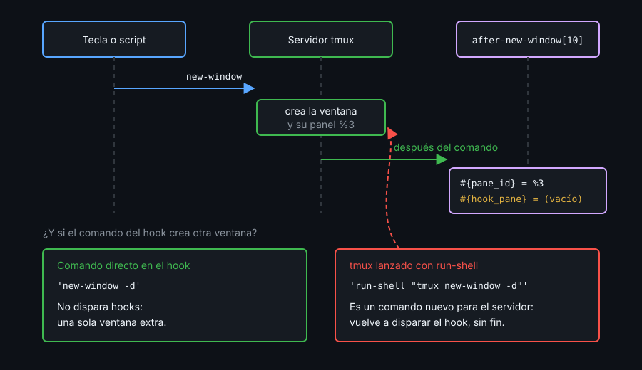

# Contexto — Hooks, run-shell y pipe-pane

## ¿Por qué importa esto?

Hasta ahora tmux solo hacía algo cuando pulsabas una tecla o lanzabas un script. Un hook es un comando que tmux ejecuta solo, cuando pasa algo: se crea una ventana, se conecta un cliente, nace una sesión. Bien usado, abre el log de cada panel nuevo. Mal usado, se ejecuta dos veces tras cada recarga o se dispara a sí mismo, sin dar error.

## Hooks



- Un hook es una opción de tipo **lista**: `set-hook -g X 'cmd'` sustituye la entrada `[0]`; `-a` añade una al final. Una config con `-ga` que recargas dos veces deja el comando duplicado.
- Un **índice fijo** (`'X[10]'`) es idempotente: recargar sustituye siempre la misma entrada. `-u 'X[10]'` borra solo esa; `-u X`, todas.
- `after-<comando>` corre justo después del comando; los eventos (`session-created`, `client-attached`, `pane-died`) cuando ocurren.
- El hook se expande como format, pero solo donde el comando lo hace (`set -F`, `display`). En `after-new-window`/`after-split-window`, `#{hook_pane}` sale **vacío**: el panel nuevo es `#{pane_id}`. En `session-created`, la sesión es `#{hook_session_name}`.
- Un comando escrito en el hook no dispara hooks; un `tmux …` lanzado con `run-shell` sí. `after-new-window` → `run-shell 'tmux new-window'` no para.

## run-shell y pipe-pane

`run-shell 'cmd'` ejecuta una shell desde el servidor y **espera**: si lo lanza una tecla, el cliente no atiende otras hasta que termina. Su salida no vuelve a quien lo llamó: abre el panel activo en modo vista (`q` lo cierra). `-b` no espera; `-C` ejecuta un comando de tmux en vez de una shell. Dentro, `$TMUX` apunta al mismo servidor: un `tmux` sin `-L` le habla a él.

`pipe-pane -o 'cmd'` manda lo que sale en el panel al stdin de `cmd`, y si ya había un pipe lo **cierra**: es un interruptor. `#{pane_pipe}` dice si está abierto. Su comando **se expande como format**: un `#` de la ruta se escribe `##`, y una ruta con `'` necesita `'\''`.

## Referencia rápida

| Comando | Para qué |
|---|---|
| `set-hook -g 'after-new-window[10]' 'cmd'` | Hook que no se duplica al recargar |
| `set-hook -gu 'after-new-window[10]'` | Borrar solo esa entrada |
| `show-hooks -g \| grep '\['` | Ver los hooks con valor |
| `set -gF @last "#{hook_session_name}"` | Guardar un dato del evento (`-F` expande) |
| `run-shell -b 'cmd'` | Shell sin bloquear al cliente |
| `run-shell -C 'display -p "#S"'` | Comando de tmux, no shell |
| `pipe-pane -o 'cat >> /ruta/log'` | Abrir o cerrar el log del panel |

## Ejemplo mínimo funcional

```bash
tmux -L demo -f /dev/null new-session -d -s demo -x 100 -y 20
for i in 1 2; do   # como recargar dos veces una config con -ga
  tmux -L demo set-hook -ga after-new-window 'set -gF @n "#{e|+:#{@n},1}"'
done
tmux -L demo set-hook -g 'session-created[10]' 'set -gF @last "#{hook_session_name}"'
tmux -L demo set-hook -g 'after-split-window[10]' 'set -gF @pane "hook=#{hook_pane} nuevo=#{pane_id}"'
tmux -L demo show-hooks -g | grep '\['
tmux -L demo new-window -d; tmux -L demo show -gv @n
tmux -L demo set-hook -gu after-new-window
tmux -L demo new-session -d -s api; tmux -L demo show -gv @last
tmux -L demo split-window -d -t demo:0 -P -F '#{pane_id}'; tmux -L demo show -gv @pane
tmux -L demo run-shell 'exit 3'; echo "run-shell: rc=$?"
tmux -L demo run-shell -C 'display -p "sesión #{session_name}"'
tmux -L demo run-shell -b 'tmux set -g @bg "${TMUX%%,*}"'; sleep 1; tmux -L demo show -gv @bg
tmux -L demo pipe-pane -o -t demo:0.0 'cat >> /tmp/pp-#{session_name}.log'
tmux -L demo display -p -t demo:0.0 'pipe=#{pane_pipe}'; ls /tmp/pp-*
tmux -L demo pipe-pane -o -t demo:0.0
tmux -L demo display -p -t demo:0.0 'pipe=#{pane_pipe}'
tmux -L demo kill-server; rm -f /tmp/pp-demo.log
```

## Qué observar

- `show-hooks` lista `after-new-window[0]` y `[1]` con el mismo comando, y una ventana nueva deja `@n` en `2`: el hook corrió dos veces. Los de índice `[10]` salen una sola vez.
- `@last` vale `api`; `@pane` vale `hook= nuevo=%3`, con el mismo `%N` (algo como `%3`) que imprimió `split-window -P`.
- `run-shell 'exit 3'` sale con `rc=3` sin imprimir nada aquí: el mensaje fue al modo vista del panel. `-C` sí imprime, `sesión api`: sin cliente, la sesión actual es la última creada.
- `@bg` vale `/tmp/tmux-1000/demo` (cambia tu uid): el job de `-b` habló con este servidor sin `-L`.
- El log se llama `/tmp/pp-demo.log`: tmux expandió `#{session_name}`. El segundo `pipe-pane -o` lo cierra (`pipe=0`).

---
Listo. Ve al [lab-01](../2-practicas/lab-01-hooks/README.md) y ponlo en práctica.

<!-- nav -->
---

## 🔗 Navegación

| Anterior | Siguiente |
|---|---|
| ← [Semana 10 — Hooks, popups y menús](../README.md) | [Teoría — Contexto — Popups, menús y prompts](02-popups-menus-y-prompts.md) → |

[↑ Semana 10](../README.md)
