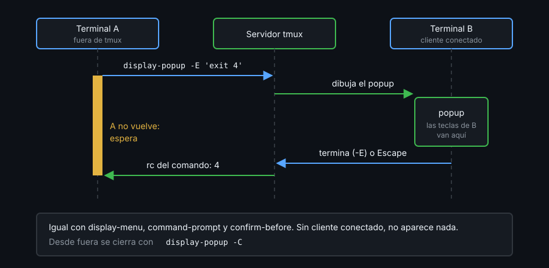

# Contexto — Popups, menús y prompts

## ¿Por qué importa esto?

Un script del kit que necesita preguntarte algo (qué proyecto abrir, si de verdad cierras la sesión) no tiene panel propio: popups, menús y prompts son la interfaz de tmux para eso. Dos trampas: el texto que escribes en un prompt puede acabar ejecutado como comando de tmux, y lo que lanzas desde fuera no vuelve hasta que alguien cierra la ventana.

## Popups

`display-popup` abre una terminal flotante con un comando dentro (`-w`/`-h`, `-T` título, `-d` directorio).

- **`-E`** cierra el popup al terminar el comando; **`-EE`** solo si sale con 0, para que un error se lea. Sin `-E` queda abierto: `q` no lo cierra, `Escape` sí.
- En 3.4 su comando **no se expande como format**: `#{session_name}` llega literal a la shell. Pregúntalo desde dentro (`tmux show -gv @kit-dir`): ahí `$TMUX` apunta al mismo servidor.
- Con fzf en un popup, el script cambia de sesión **por id** (`switch-client -t '$3'`), nunca reescribiendo el nombre en un comando.

## Menús, prompts y confirmaciones

`display-menu` recibe ternas `nombre tecla comando`; `''` es un separador. Nombres y comandos se expanden como format **al abrir el menú**: nunca pongas `#{session_name}` dentro del comando de una entrada.

`command-prompt` sustituye lo que escribes en `%%` (o `%1`, `%2` con varios `-p`). Dónde está la plantilla lo decide todo:

- Entre **llaves** `{ rename-window "%%" }`, lo escrito va como valor de un argumento: seguro.
- Como **texto** `"rename-window '%%'"`, tmux pega lo escrito y vuelve a parsear: `x"; set -g @pwn si; set -g @z "` ejecuta `set -g @pwn si`. Las comillas no protegen.
- `run-shell "… %%"` lleva lo escrito a una shell aunque uses llaves.


## Bloquean hasta cerrarse



Lanzados desde un script o la terminal A, no vuelven hasta que el cliente responde; sin cliente conectado no aparece nada. Ciérralos con `Escape` (`q` en un menú) o `display-popup -C`.

## Referencia rápida

| Comando | Para qué |
|---|---|
| `display-popup -E -w 80% -h 80% top` | Programa a pantalla casi completa; se cierra con él |
| `display-popup -EE "$dir/bin/script"` | Si el script falla, el error queda a la vista |
| `display-menu -T ' kit ' -x C -y C 'Nueva' n new-window` | Menú centrado |
| `command-prompt -p 'nombre:' { rename-window "%%" }` | Prompt sin inyección |
| `confirm-before -p 'cerrar? (y/n)' kill-session` | Acción destructiva con confirmación |
| `display-popup -C` | Cerrar el popup abierto |

## Ejemplo mínimo funcional

En una terminal fuera de tmux (`echo "$TMUX"` vacío). El servidor arranca sin `set -g prefix`: el prefix es `C-b`.

```bash
cat > /tmp/demo.conf <<'EOF'
bind y display-popup -E -T ' info ' -w 50 -h 6 'tmux display -p "sesión: #S"; read -r'
bind u display-popup -E -w 80% -h 80% top
bind K display-menu -T ' demo ' -x C -y C \
  'Nueva ventana'  n new-window \
  'Renombrar'      r { command-prompt -p 'nombre:' { rename-window "%%" } } \
  '' \
  'Cerrar ventana' x { confirm-before -p 'cerrar ventana? (y/n)' kill-window }
EOF
tmux -L demo -f /tmp/demo.conf new -s demo
```

Dentro, pulsa en orden: `C-b` `y` y `Enter`; `C-b` `u` y `q`; `C-b` `K` `n`; `C-b` `K` `r`, escribe `x"; set -g @pwn si; set -g @z "` y `Enter`; `C-b` `K` `x` `y`. Al acabar, `C-b` `d` imprime `[detached (from session demo)]`, y cierras con:

```bash
tmux -L demo show -gv @pwn; tmux -L demo kill-server; rm /tmp/demo.conf
```

## Qué observar

- El popup ` info ` muestra `sesión: demo` y se cierra con `Enter`: `read -r` termina y `-E` cierra.
- `q` cierra a la vez `top` y su popup.
- La ventana renombrada se llama, literal, `x"; set -g @pwn si; set -g @z "`, y `show -gv @pwn` dice `invalid option: @pwn`: las llaves la protegieron.
- `x` no cierra nada hasta que respondes `y`.

---
Listo. Ve al [lab-02](../2-practicas/lab-02-popups/README.md) y ponlo en práctica.

<!-- nav -->
---

## 🔗 Navegación

| Anterior | Siguiente |
|---|---|
| ← [Teoría — Contexto — Hooks, run-shell y pipe-pane](01-hooks-y-run-shell.md) | [Índice de labs](../2-practicas/README.md) → |

[↑ Semana 10](../README.md)
