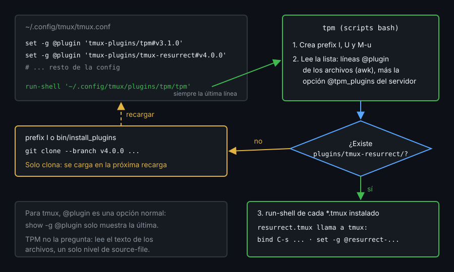

# Contexto — Qué es un plugin y cómo lo carga TPM

## ¿Por qué importa esto?

Si sabes que un plugin es un script que llama a `tmux` y que TPM solo lo clona y lo ejecuta, puedes depurar el que no carga, escribir el tuyo y decidir cuándo diez líneas de config valen más que una dependencia.

## Anatomía de un plugin

Un plugin es un repositorio con un ejecutable `*.tmux` en la raíz. `run-shell` lo lanza con `$TMUX` puesto y el script usa `tmux set`, `bind-key` y `show`. Tres patrones:

- **Su directorio**: `dir="$(cd "$(dirname "${BASH_SOURCE[0]}")" && pwd)"`, para apuntar a sus scripts.
- **Opciones con valor por defecto**: tú fijas `@opcion` **antes** de cargarlo; el plugin la lee con `tmux show -gqv @opcion` (`-q`: vacío y sin error si no existe) y solo pone la suya si está vacía.
- **Interpolación**: escribes un marcador como `#{cpu_percentage}` en `status-right` y el plugin lo cambia por algo que tmux entiende, casi siempre `#(ruta/al/script)`. Va después de `status-right`.

Recargar lo ejecuta otra vez: un `set -ga` sin comprobar se acumula.

## TPM



- Declaras `set -g @plugin 'usuario/repo#tag'` y, como **última línea**, `run-shell '~/.config/tmux/plugins/tpm/tpm'`: TPM ejecuta cada plugin con las opciones que haya en ese momento.
- `prefix` `I` instala, `prefix` `U` actualiza y `prefix` `M-u` borra los que ya no declaras. Sin teclado: `bin/install_plugins`, `bin/update_plugins all`, `bin/clean_plugins`. Instalar solo clona: carga en la siguiente recarga.
- Los plugins van a `~/.config/tmux/plugins/` con config XDG (si no, a `~/.tmux/plugins/`). `TMUX_PLUGIN_MANAGER_PATH` lo cambia (con barra final).
- **TPM no le pregunta a tmux.** TPM busca con `awk` las líneas `set -g @plugin` en `tmux.conf` y en los archivos de sus `source-file`, un nivel y con la ruta literal. Un `source-file -F "#{@kit-dir}/conf.d/*.conf"` lo deja ciego: no instala nada y sale con 0. La alternativa, que TPM sí lee del servidor, es `set -g @tpm_plugins '...'` con la lista separada por espacios: la usa tu kit.

## Fijar versiones

`usuario/repo#tag` clona ese tag. Sin tag, cada máquina clona lo que haya ese día en la rama principal. `update_plugins` no te saca del tag: para cambiarlo, borra la carpeta del plugin e instala.

## Cuándo no instalar un plugin

- Cuando cabe en diez líneas de config que ya sabes escribir (opciones "sensatas", teclas, status line).
- Cuando no has leído su `*.tmux`: corre con tus permisos en cada carga.
- Cuando añade un `#(...)` caro que corre cada `status-interval`.

Compensa si resuelve algo difícil, como restaurar sesiones.

## Referencia rápida

| Pieza | Para qué |
|---|---|
| `tmux show -gqv @opcion` | Leer una opción; vacío si no existe |
| `set -g @plugin 'tmux-plugins/tmux-resurrect#v4.0.0'` | Declarar un plugin fijado por tag |
| `run-shell '~/.config/tmux/plugins/tpm/tpm'` | Cargar TPM: última línea |
| `~/.config/tmux/plugins/tpm/bin/install_plugins` | Instalar sin teclado |
| `run-shell /ruta/plugin.tmux` | Cargar un plugin sin TPM |

## Ejemplo mínimo funcional

Terminal fuera de tmux (`echo "$TMUX"` vacío). Un plugin mínimo, cargado sin TPM en un servidor `-L demo` (sin `set -g prefix`, así que su prefix es `C-b`):

```bash
mkdir -p /tmp/hola && cat > /tmp/hola/hola.tmux <<'EOF'
#!/usr/bin/env bash
set -euo pipefail
dir="$(cd "$(dirname "${BASH_SOURCE[0]}")" && pwd)"
# Valor por defecto solo si el usuario no fijó @hola-text antes de cargar
[ -n "$(tmux show -gqv @hola-text)" ] || tmux set -g @hola-text 'hola'
tmux bind-key H display-message "#{@hola-text} desde $dir"
# Interpolación: cambia el marcador #{hola} por un format que tmux entiende
marker='#{hola}' value='#{@hola-text}'
right="$(tmux show -gqv status-right)"
tmux set -g status-right "${right//"$marker"/"$value"}"
EOF
chmod +x /tmp/hola/hola.tmux
cat > /tmp/demo.conf <<'EOF'
set -g status-right '#{hola} | %H:%M'
set -g @hola-text 'buenas'
run-shell /tmp/hola/hola.tmux
EOF
tmux -L demo -f /tmp/demo.conf new -d -s demo
tmux -L demo show -gv status-right
tmux -L demo list-keys -T prefix H
```

```
#{@hola-text} | %H:%M
bind-key -T prefix H display-message "#{@hola-text} desde /tmp/hola"
```

```bash
tmux -L demo run-shell /tmp/hola/hola.tmux; tmux -L demo show -gv status-right
tmux -L demo display -p '#{E:status-right}'
chmod -x /tmp/hola/hola.tmux; tmux -L demo run-shell /tmp/hola/hola.tmux; echo $?
tmux -L demo kill-server; rm -rf /tmp/hola /tmp/demo.conf
```

Algo como (cambia la hora):

```
#{@hola-text} | %H:%M
buenas | 20:33
126
```

## Qué observar

- `@hola-text` vale `buenas`, no `hola`: la fijaste antes del `run-shell`.
- El marcador desapareció: ejecutarlo otra vez no cambia nada.
- Sin permiso de ejecución, `run-shell` sale con 126 y no dice nada más.

<!-- nav -->
---

## 🔗 Navegación

| Anterior | Siguiente |
|---|---|
| ← [Semana 11 — Plugins y ecosistema](../README.md) | [Teoría — Contexto — resurrect, continuum y gestores de sesiones](02-resurrect-continuum-y-gestores.md) → |

[↑ Semana 11](../README.md)
