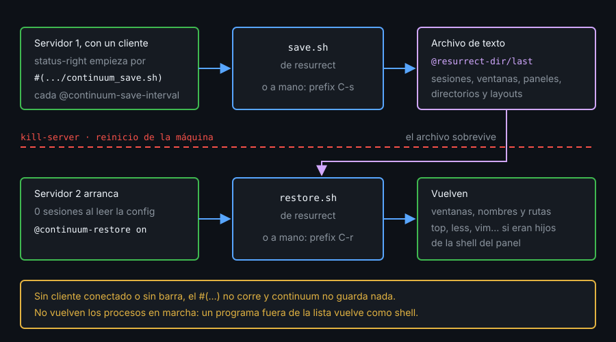

# Contexto — resurrect, continuum y gestores de sesiones

## ¿Por qué importa esto?

Reiniciar la máquina mata el servidor y tus sesiones. tmux-resurrect las guarda en un archivo de texto y las recrea; tmux-continuum lo hace solo, sin que te acuerdes. tmuxp y sesh declaran una sesión en un archivo o la encuentran rápido. Saber qué guarda cada uno evita descubrirlo el día que lo necesitas.

## tmux-resurrect

- `prefix` `C-s` guarda y `prefix` `C-r` restaura. Sin teclado: `run-shell .../tmux-resurrect/scripts/save.sh` y `.../scripts/restore.sh`.
- **Qué guarda**: sesiones, ventanas con su nombre, paneles, directorio de cada panel y layout. Con `@resurrect-capture-pane-contents on`, también su contenido.
- **Qué no**: los procesos. Solo relanza programas de una lista (`vim`, `less`, `top`, `tail`, `man`...) y solo si eran hijos de la shell del panel: `send-keys top Enter` vuelve como `top`, `new-window top` vuelve como shell.
- **Dónde**: `@resurrect-dir`, que por defecto es `~/.tmux/resurrect` (la v4.0.0 no sigue XDG). Cada guardado es un `tmux_resurrect_FECHA.txt`, y el enlace `last` apunta al más reciente. Tu kit lo deja en `~/.local/share/tmux/resurrect`.
- Lee sus opciones al cargarse: van antes del `run-shell` (o del de TPM).

## tmux-continuum



- **Autoguardado**: antepone a `status-right` un `#(.../continuum_save.sh)` que llama al `save.sh` de resurrect cada `@continuum-save-interval` minutos (15 por defecto). Un `#(...)` solo corre al dibujar la barra de un cliente: sin cliente conectado, o con la barra apagada, no guarda nada.
- Solo se activa si es **el único servidor** de tmux en marcha. Con `-L lab` y tu tmux abierto, no autoguarda.
- **`@continuum-restore on`**: un servidor que arranca sin sesiones restaura el último guardado al leer la config. Si tu comando crea una sesión que ya venía guardada (`new -d -s lab`), falla con `duplicate session`.
- Necesita resurrect cargado antes y va después de tu `status-right`.

## tmuxp y sesh

**tmuxp** (Python) crea sesiones desde un YAML: ventanas, paneles, directorios y comandos. Se instala con `uv tool install "tmuxp==1.76.*"`, nunca con pip. `tmuxp load -d` crea la sesión sin conectarse; si ya existe, no toca nada. `tmuxp freeze` escribe el YAML de una sesión viva. Frente a `bin/dev-up`: el YAML se lee de un vistazo, pero la lógica vuelve a pedir bash.

**sesh** es un binario en Go que, junto con fzf, lista y abre sesiones y directorios. Se instala desde su release oficial; lo ves en el reto extra del lab 05.

## Referencia rápida

| Pieza | Para qué |
|---|---|
| `set -g @resurrect-capture-pane-contents on` | Guardar también lo que se veía |
| `set -g @continuum-save-interval 15` | Minutos entre guardados; `0` lo apaga |
| `tmuxp load -d api.yaml` | Crear la sesión del YAML sin conectarse |
| `tmuxp freeze -y -o api.yaml api` | YAML de la sesión `api` |

## Ejemplo mínimo funcional

Terminal fuera de tmux (`echo "$TMUX"` vacío), con `git` y red (el laboratorio Docker los trae). El servidor `-L demo` carga resurrect sin TPM y guarda en `/tmp`, lejos de tu `$HOME`:

```bash
git clone -q --depth 1 --branch v4.0.0 https://github.com/tmux-plugins/tmux-resurrect /tmp/resurrect
cat > /tmp/demo.conf <<'EOF'
set -g @resurrect-dir '/tmp/demo-guardado'
run-shell /tmp/resurrect/resurrect.tmux
EOF
tmux -L demo -f /tmp/demo.conf new -d -s demo -n editor -c /tmp
tmux -L demo new-window -t demo: -n logs -c /var/log
tmux -L demo list-keys -T prefix C-s
tmux -L demo run-shell /tmp/resurrect/scripts/save.sh; echo $?
ls /tmp/demo-guardado
```

`git` avisa de `detached HEAD` (un tag no es rama). Algo como (cambia la fecha):

```
bind-key -T prefix C-s run-shell /tmp/resurrect/scripts/save.sh
0
last
tmux_resurrect_20261103T203406.txt
```

```bash
tmux -L demo kill-server; sleep 1
tmux -L demo -f /tmp/demo.conf new -d -s tmp
tmux -L demo run-shell /tmp/resurrect/scripts/restore.sh; echo $?
tmux -L demo list-windows -a -F '#{session_name}:#{window_index} #{window_name} #{pane_current_path}'
tmux -L demo kill-server; rm -rf /tmp/resurrect /tmp/demo-guardado /tmp/demo.conf
```

Algo como (la ruta de `tmp` es la carpeta desde la que lo lanzas):

```
0
demo:0 editor /tmp
demo:1 logs /var/log
tmp:0 bash /bc-tmux
```

## Qué observar

- `demo` vuelve con sus dos ventanas, sus nombres y sus directorios, aunque el servidor murió.
- La sesión `tmp` sigue ahí: restaurar añade, no sustituye lo que ya hay.

---
Listo. Ve al [lab-01](../2-practicas/lab-01-tpm-desde-cero/README.md) y ponlo en práctica.

<!-- nav -->
---

## 🔗 Navegación

| Anterior | Siguiente |
|---|---|
| ← [Teoría — Contexto — Qué es un plugin y cómo lo carga TPM](01-que-es-un-plugin-y-tpm.md) | [Índice de labs](../2-practicas/README.md) → |

[↑ Semana 11](../README.md)
