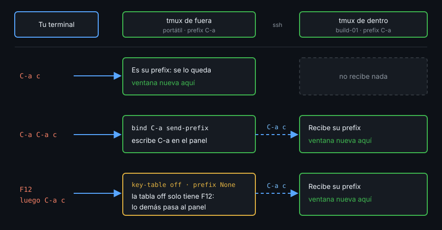

# Contexto — tmux remoto y tmux anidado

## ¿Por qué importa esto?

Una conexión SSH se corta. Con tmux en la máquina remota, solo pierdes el cliente. Y con tmux en tu portátil y en el servidor, uno dentro del otro, necesitas saber a cuál llega cada tecla.

## El servidor vive en la máquina remota

```bash
ssh -t build-01 tmux new -A -s main
```

- `new -A` se conecta a `main` si existe y la crea si no: sirve para entrar y para volver.
- `-t` le da a ssh una terminal. Sin ella, tmux sale con `open terminal failed: not a terminal`.
- Si la conexión muere, el servidor de `build-01` y sus procesos siguen: `tmux ls` muestra `main` sin `(attached)`. Repites el comando y vuelves.
- Cortar una conexión colgada: `Enter` `~` `.`.

**mosh** sustituye a ssh, no a tmux: va por UDP, sobrevive a un cambio de IP y a la suspensión, y muestra lo que escribes sin esperar. Sincroniza solo la pantalla visible, y si cierras la terminal local no vuelves a ese mosh, pero sí a tmux. Lo que no es pantalla, como OSC 52 (semana 04), pasa solo si mosh lo entiende.

## tmux dentro de tmux



El tmux de dentro es un programa más en un panel del de fuera. Con el mismo prefix en los dos, el de dentro nunca recibe el suyo. Tres salidas:

1. **Prefix doble**: con `bind C-a send-prefix`, `prefix` `C-a` escribe `C-a` en el panel y la tecla siguiente va al de dentro.
2. **Otro prefix en el servidor**: funciona, pero recuerdas dos.
3. **Apagar el de fuera** con una tecla: el toggle.

Sobre el mismo socket, tmux avisa: `sessions should be nested with care, unset $TMUX to force`. Por SSH no: `$TMUX` no viaja.

## El toggle: la tabla `off`

```tmux
bind -n F12 set prefix None \; set key-table off
bind -T off F12 set -u prefix \; set -u key-table
```

- `key-table` es la tabla donde empieza cada tecla. `off` solo tiene `F12`: lo demás llega al panel, al tmux de dentro.
- `set` sin `-g` cambia esta sesión; las demás siguen encendidas.
- `set -u` borra el valor de la sesión y vuelve a heredar el global: no hay que recordar el prefix anterior, y recargar no lo deshace.
- Indicador sin cliente: `#{?#{==:#{key-table},off},OFF,}` en `status-right`.

## Una barra distinta en remoto

Un format no lee variables de entorno; `if-shell` sí, al cargar la config:

```tmux
if-shell '[ -n "$SSH_CONNECTION" ]' {
  set -g @kit-remote on
} {
  set -g @kit-remote off
}
```

Ve el entorno con el que **arrancó el servidor**, no el de cada cliente. Basta para pintar de otro color la barra de dentro.

## Referencia rápida

| Pieza | Para qué |
|---|---|
| `ssh -t host tmux new -A -s main` | Entrar o volver a la misma sesión |
| `bind C-a send-prefix` | `prefix` `C-a` manda el prefix al de dentro |
| `set prefix None` / `set -u prefix` | Quitar el prefix a la sesión / volver al global |

## Ejemplo mínimo funcional

Un cliente de control mode recibe teclas con `send-keys -K` (en el laboratorio, fuera de tmux):

```bash
cat > /tmp/toggle.conf <<'EOF'
bind -n F12 set prefix None \; set key-table off
bind -T off F12 set -u prefix \; set -u key-table
set -g status-right "#{?#{==:#{key-table},off},OFF,ON}"
EOF
tmux -L t -f /tmp/toggle.conf new -d -s a
( sleep 3 | tmux -L t -C attach -t a ) >/dev/null 2>&1 &
sleep 0.5
c=$(tmux -L t list-clients -F '#{client_name}')
tmux -L t send-keys -K -c "$c" F12
tmux -L t show -v prefix; tmux -L t show -v key-table
tmux -L t display -p '#{E:status-right}'
tmux -L t send-keys -K -c "$c" F12
tmux -L t show -v key-table; echo $?
tmux -L t display -p '#{E:status-right} #{prefix}'
tmux -L t kill-server
```

```
None
off
OFF
0
ON C-b
```

## Qué observar

- Tras el segundo `F12`, `show -v key-table` no imprime nada y sale con 0: la sesión ya no tiene valor propio.
- `#{prefix}` vuelve al global, `C-b`, sin que el binding lo nombre.

<!-- nav -->
---

## 🔗 Navegación

| Anterior | Siguiente |
|---|---|
| ← [Semana 12 — Remoto, colaboración y control mode](../README.md) | [Teoría — Contexto — Compartir una sesión y control mode](02-compartir-y-control-mode.md) → |

[↑ Semana 12](../README.md)
