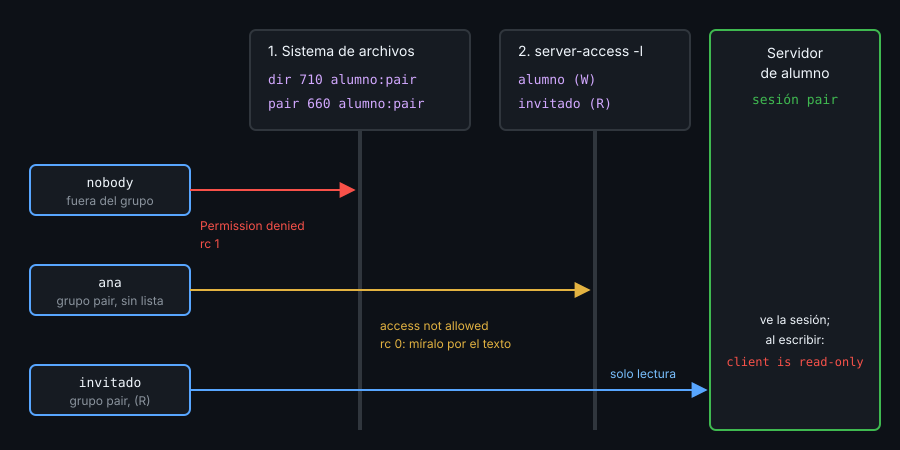

# Contexto — Compartir una sesión y control mode

## ¿Por qué importa esto?

Quien escribe en tu tmux tiene tu shell, con tus claves y permisos. Compartir una sesión es útil solo si decides tú quién entra y si puede escribir.

## El socket es la primera puerta

El cliente habla con el servidor por un socket Unix; el sistema de archivos decide quién llega.

- `-L nombre` vive en `/tmp/tmux-UID/nombre`, un directorio `700`: nadie más llega, aunque el socket tenga otros permisos. Para compartir hace falta `-S ruta`.
- tmux crea el socket `600`. Lo abres a un grupo, no al mundo: directorio `710` y socket `660`, los dos del grupo compartido (`pair`). Con `710`, el grupo atraviesa el directorio pero no puede listarlo.
- Fuera del grupo: `error connecting to ... (Permission denied)`, código 1.

## `server-access`: la segunda puerta



Desde tmux 3.3, el servidor guarda además una lista de usuarios:

- `server-access -a -r invitado` lo añade en solo lectura. **`-a` sin `-r` da escritura.**
- `-l` lista (`alumno (W)`, `invitado (R)`); el dueño aparece siempre. `-w`/`-r` cambian el modo en vivo, y `-d` lo quita y desconecta su cliente.
- Un usuario del grupo fuera de la lista recibe `access not allowed`, **con código 0**: compruébalo por el texto.
- Vive en la memoria del servidor: uno nuevo empieza vacío.

En (R), el invitado ve la sesión y sale con `prefix` `d`; cualquier comando suyo (`send-keys`, `new-window`, `ls`) da `client is read-only`.

## `attach -r` no es una frontera

`attach -r` marca el cliente como solo lectura, pero lo elige quien se conecta. Con (W), el invitado lo deshace con `switch-client -r` o, sin conectarse, escribe con `send-keys -t pair 'comando' Enter` desde otra shell. Lo único que protege es `server-access -r`.

## Cada uno su ventana: grupos de sesiones

Las sesiones de un grupo comparten ventanas, pero cada una tiene su ventana actual. Crea una para el invitado; tú eliges qué mira:

```bash
tmux -S /tmp/pareja/s new -d -t pair -s lucia   # el invitado: attach -t lucia
tmux -S /tmp/pareja/s select-window -t lucia:1  # tú sigues en tu ventana
```

## Control mode

`tmux -C` cambia la pantalla por un protocolo de texto: comandos por la entrada estándar, respuestas y eventos por la salida. Lo usan iTerm2 y los scripts que reaccionan a tmux.

- Cada comando responde entre `%begin` y `%end` (o `%error`), con el mismo número de orden.
- Eventos sueltos: `%window-add @1`, `%session-changed $0 cm`, `%output %1 texto` (no imprimibles en octal: `\015\012`) y `%exit` al acabar.
- `-CC` es el modo de iTerm2: necesita una terminal real, y iTerm2 dibuja las ventanas de tmux como suyas.

## Referencia rápida

| Pieza | Para qué |
|---|---|
| `tmux -S /dir/s new -d -s pair` | Servidor en una ruta compartible |
| `chgrp pair` + `chmod 710` / `660` | Directorio y socket solo para el grupo |
| `server-access -a -r USUARIO` | Añadir en solo lectura |

## Ejemplo mínimo funcional

```bash
tmux -L cm -f /dev/null new -d -s cm
printf '%s\n' 'list-windows -F "#{window_id} #{window_name}"' \
  'new-window -d -n logs' 'display -p nope-#{session_name}' |
  timeout 3 tmux -L cm -C attach -t =cm; echo "rc=$?"
tmux -L cm kill-server
```

Algo como (el primer número de `%begin` es la hora y el segundo cambia):

```
%begin 1793743330 269 0
%end 1793743330 269 0
%session-changed $0 cm
%begin 1793743330 274 1
@0 bash
%end 1793743330 274 1
%begin 1793743330 275 1
%end 1793743330 275 1
%begin 1793743330 276 1
parse error: syntax error
%error 1793743330 276 1
%window-add @1
%exit
rc=0
```

## Qué observar

- La última flag de `%begin` es `1` en los comandos que mandaste y `0` en el `attach`.
- `nope-#{session_name}` sin comillas da `%error`: `#` empieza un comentario. Cita siempre los formats.

---
Listo. Ve al [lab-01](../2-practicas/lab-01-ssh-y-sesion-persistente/README.md) y ponlo en práctica.

<!-- nav -->
---

## 🔗 Navegación

| Anterior | Siguiente |
|---|---|
| ← [Teoría — Contexto — tmux remoto y tmux anidado](01-remoto-y-anidado.md) | [Índice de labs](../2-practicas/README.md) → |

[↑ Semana 12](../README.md)
