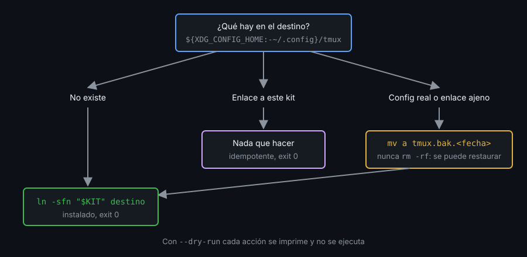

# Contexto — Instalar el kit

## ¿Por qué importa esto?

Hasta ahora arrancabas el kit con `-f ruta/tmux.conf`. Instalarlo es que `tmux` a secas lo cargue en cualquier máquina, sin perder la config que ya había y con una forma de deshacerlo. Un instalador que pisa `~/.config/tmux` destruye trabajo ajeno.

## Enlazar el directorio, no copiarlo

El instalador crea un solo enlace: `~/.config/tmux` apunta al directorio del kit. Un `git pull` en el kit actualiza la config instalada; una copia se queda vieja.

tmux resuelve el enlace al leer la config: `#{config_files}` muestra la ruta real (`.../kit/tmux.conf`), así que `#{d:current_file}` es el directorio del kit y `conf.d/`, `bin/` y `plugin/` siguen donde los busca tu `tmux.conf`.

## Las trampas de `ln`

- `ln -s kit destino` crea el enlace **dentro** de `destino` si este es un directorio o un enlace a uno. La segunda ejecución deja un `kit/kit` y sale con 0: nadie se entera.
- `-n` trata un enlace a directorio como un archivo y `-f` lo sustituye: `ln -sfn` es idempotente.
- Sobre un directorio **real**, ni `-n` lo evita: también crea el enlace dentro. Antes de enlazar, ese directorio se mueve a un backup.

## Qué hacer según lo que ya hay



El backup lleva fecha (`tmux.bak.20261103-231312`): ordenados por nombre, el último es el más reciente, y nunca se pisan. Nunca `rm -rf`.

## Dónde y qué más se carga

- Destino: `${XDG_CONFIG_HOME:-$HOME/.config}/tmux`. Si la variable está definida, tmux busca ahí y no en `~/.config`.
- tmux carga **todos** los archivos de config que existen: `/etc/tmux.conf`, `~/.tmux.conf` y el de XDG, en ese orden. Un `~/.tmux.conf` heredado se aplica antes que el kit y lo que este no redefina sobrevive. El instalador avisa; no lo borra.

## Ensayar y deshacer

- `--dry-run` imprime cada acción (`mv ...`, `ln -sfn ...`) sin ejecutarla.
- `--uninstall` borra el enlace solo si `readlink` apunta a este kit, y restaura el backup más reciente. Si apunta a otro sitio, no es tuyo: no lo toca y sale con 1.
- Códigos de salida: 0 hecho (o nada que hacer), 1 se negó a actuar o tmux es viejo, 2 uso incorrecto (opción desconocida).
- Antes de tocar nada, `bin/check-version 3.4`: si falla, el instalador sale sin cambios.

## Linux y macOS

La ruta del kit sale de `cd "$(dirname "$0")" && pwd -P`: funciona lanzado desde cualquier directorio y `-P` resuelve enlaces. `readlink -f` no está en todos los macOS.

## Referencia rápida

| Pieza | Para qué |
|---|---|
| `ln -sfn "$KIT" "$DEST"` | Enlace idempotente al kit |
| `[[ -L $DEST ]]` / `readlink "$DEST"` | ¿Es enlace? ¿Adónde apunta? |
| `mv "$DEST" "$DEST.bak.$(date +%Y%m%d-%H%M%S)"` | Backup que no se pisa |
| `#{config_files}` | Archivos que tmux cargó al arrancar |

## Ejemplo mínimo funcional

Fuera de tmux, en un HOME temporal:

```bash
H=$(mktemp -d); mkdir -p "$H/kit/conf.d" "$H/.config/tmux"
echo 'set -g prefix C-a' > "$H/kit/conf.d/10-options.conf"
echo 'source-file -F "#{d:current_file}/conf.d/*.conf"' > "$H/kit/tmux.conf"
echo 'set -g status off' > "$H/.config/tmux/tmux.conf"   # config previa
echo 'set -g status-left VIEJO' > "$H/.tmux.conf"         # config heredada
cd "$H/.config" || exit
mv tmux "tmux.bak.$(date +%Y%m%d-%H%M%S)"
ln -sfn "$H/kit" tmux
ln -sfn "$H/kit" tmux                                      # 2ª vez: nada cambia
ls "$H/kit"; ls; readlink tmux
env -u XDG_CONFIG_HOME HOME="$H" tmux -L t13 new -d \; \
  display -p '#{config_files}' \; show -gv prefix \; show -gv status-left
tmux -L t13 kill-server
```

Algo como (cambian el directorio temporal y la fecha):

```
conf.d
tmux.conf
tmux
tmux.bak.20261103-231312
/tmp/tmp.EDwxexMwHS/kit
/tmp/tmp.EDwxexMwHS/.tmux.conf,/tmp/tmp.EDwxexMwHS/kit/tmux.conf
C-a
VIEJO
```

## Qué observar

- Tras dos `ln -sfn`, el kit sigue teniendo solo `conf.d` y `tmux.conf`: no hay `kit/kit`. Cámbialo por `ln -s` y repite para verlo aparecer.
- `config_files` lista dos archivos, y `VIEJO` viene del `~/.tmux.conf` heredado.
- `status off` no se aplicó: la config previa está a salvo en el backup, no cargada.

<!-- nav -->
---

## 🔗 Navegación

| Anterior | Siguiente |
|---|---|
| ← [Semana 13 — Proyecto integrador](../README.md) | [Teoría — Contexto — Probar y auditar el kit](02-probar-y-auditar-el-kit.md) → |

[↑ Semana 13](../README.md)
