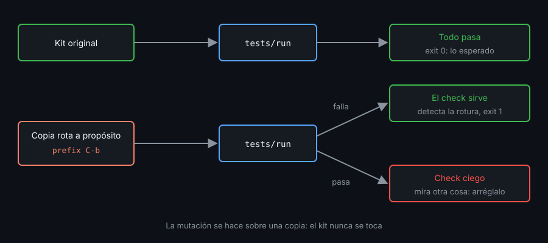

# Contexto — Probar y auditar el kit

## ¿Por qué importa esto?

Hasta ahora `verificar-semana.sh` comprobaba tu kit. Desde hoy nadie lo hace: un cambio en `conf.d/` que rompe el prefix lo descubres cuando lo necesitas. `tests/run` son tus checks: los lanzas antes de cada commit y en un segundo sabes si el kit cumple su README.

## Anatomía de un check

- **Servidor aislado**: `-L` con un nombre propio (`${TMUX_SOCKET:-kit-test}`), nunca el servidor en el que trabajas.
- **HOME temporal**: `env -u XDG_CONFIG_HOME HOME="$(mktemp -d)"`.: el instalador escribe ahí, no en tu `$HOME`.
- **Assert**: compara la salida (`show -gv prefix` debe imprimir `C-a`) o el código de salida (`dev-up` dos veces sale con 0). Una línea ✅/❌ por check; exit 0 si todos pasan, 1 si no.
- **`trap ... EXIT`**: mata el servidor y borra el HOME temporal aunque un check aborte a medias.

## Los errores de la config no se ven solos

`tmux -f kit/tmux.conf new -d` sale con 0 aunque un `conf.d/` tenga un error: tmux lo guarda para enseñarlo al primer cliente que se conecte, y con `-d` no hay ninguno. Para comprobar que la config carga, arranca con `-f /dev/null` y carga el kit con `source-file`: así el error sale por stderr y el código es 1. El mismo truco prueba la recarga: dos `source-file` seguidos no deben duplicar hooks ni bindings.

## Un test que nunca falla no prueba nada



Rompe el kit a propósito (cambia el prefix, mete una opción inexistente, borra un script) y lanza `tests/run`: tiene que salir ❌. Si sale ✅, el check mira otra cosa o se traga el error. Haz las mutaciones sobre una copia, nunca sobre el kit.

## Auditar antes de dar el kit por terminado

- **shellcheck** sobre `install.sh`, `tests/run` y todo `bin/`, sin avisos.
- **Sin TODOs**: `grep -rn TODO .` vacío.
- **Arranque**: `time tmux -L x -f kit/tmux.conf new -d` debe quedarse en milisegundos. Lo que lo frena es un `run-shell` sin `-b` en la config: tmux espera a que acabe.
- **`#()` caros**: no frenan el arranque (corren en segundo plano), pero se relanzan cada `status-interval` segundos. Mídelos fuera: `time bin/kit-git-branch`.
- **`show-messages`**: el registro de mensajes y errores del servidor; útil con un cliente conectado.

## Mantener el kit

`local.conf` (ajustes de esta máquina) va en `.gitignore`. El README es el contrato: cada atajo y script que documenta tiene un check que lo demuestra.

## Referencia rápida

| Pieza | Para qué |
|---|---|
| `tmux -L "$S" -f /dev/null new -d \; source-file kit/tmux.conf` | ¿Carga sin errores? (código 1 si no) |
| `trap 'tmux -L "$S" kill-server' EXIT` | No dejar servidores vivos |
| `shellcheck install.sh tests/run bin/*` | Scripts limpios |
| `time tmux -L x -f kit/tmux.conf new -d` | Coste de arranque |

## Ejemplo mínimo funcional

Fuera de tmux, un kit de juguete con dos mutaciones:

```bash
T=$(mktemp -d); mkdir -p "$T/kit/conf.d"
echo 'set -g prefix C-a' > "$T/kit/conf.d/10-options.conf"
echo 'source-file -F "#{d:current_file}/conf.d/*.conf"' > "$T/kit/tmux.conf"
check() (  # subshell: el trap EXIT mata el servidor al salir de check
  sock="t13-$$"; trap 'tmux -L "$sock" kill-server 2>/dev/null' EXIT
  if ! tmux -L "$sock" -f /dev/null new -d \; source-file "$1/tmux.conf"; then
    echo "❌ la config no carga"; exit 1
  fi
  got=$(tmux -L "$sock" show -gv prefix)
  if [[ $got == C-a ]]; then echo "✅ prefix C-a"; else echo "❌ prefix $got"; exit 1; fi
)
check "$T/kit"; echo "rc=$?"
echo 'set -g prefix C-b' > "$T/kit/conf.d/10-options.conf"   # mutación 1
check "$T/kit"; echo "rc=$?"
echo 'set -g nope 1' > "$T/kit/conf.d/20-roto.conf"          # mutación 2
check "$T/kit"; echo "rc=$?"
tmux -L "t13-$$" ls; echo "rc=$?"
```

Algo como (cambia el número del socket):

```
✅ prefix C-a
rc=0
❌ prefix C-b
rc=1
invalid option: nope
❌ la config no carga
rc=1
no server running on /tmp/tmux-1000/t13-7
rc=1
```

## Qué observar

- Cada mutación produce su ❌ y su código 1: el check sirve.
- `invalid option: nope` sale por stderr gracias a `source-file`; con `-f` el error se perdería.
- El último `ls` confirma que el `trap` no dejó ningún servidor vivo.

---
Listo. Ve al [lab-01](../2-practicas/lab-01-enlaces-y-xdg/README.md) y ponlo en práctica.

<!-- nav -->
---

## 🔗 Navegación

| Anterior | Siguiente |
|---|---|
| ← [Teoría — Contexto — Instalar el kit](01-instalar-el-kit.md) | [Índice de labs](../2-practicas/README.md) → |

[↑ Semana 13](../README.md)
